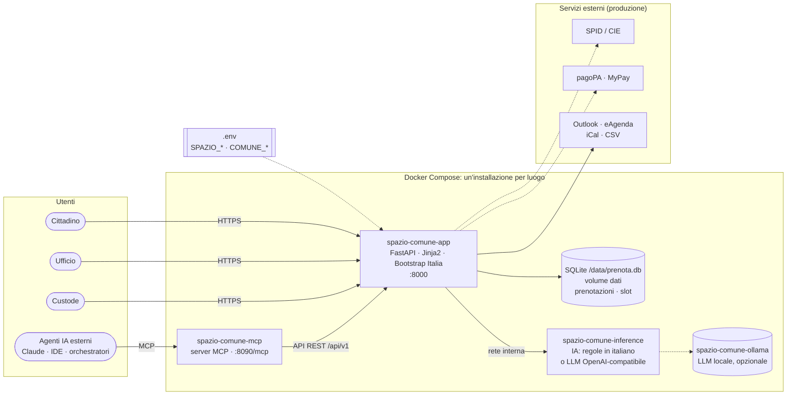

# Spazio Comune

**Prenotazione online di un luogo comunale con SPID/CIE, pagoPA, QR code e un assistente IA che trova gli orari
partendo da una frase.** Open source (EUPL-1.2), riusabile da qualsiasi Comune.
Pilota proposto: campo coperto di via Benagiano, Comune di Gioia del Colle.

**Un'installazione = un luogo.** Nome, indirizzo, Comune, orari e attività si scrivono nel file `.env`.
Un Comune con più luoghi installa una copia del repository per ciascuno: ogni luogo ha il suo indirizzo web,
il suo database e il suo ufficio di riferimento, e resta semplice da gestire.

📖 **Documentazione completa:** https://agentengineering.it/spazio-comune/


> Proposta indipendente, non un servizio ufficiale del Comune. SPID/CIE e pagoPA sono simulati; i dati della demo
> sono fittizi.

Il README è diviso in tre parti: **[Cittadini](#1-per-i-cittadini)** ·
**[Comune](#2-per-il-comune)** · **[Sviluppatori e ufficio IT](#3-per-sviluppatori-e-ufficio-it)**.

---

## 1. Per i cittadini

Oggi per un'ora di calcetto servono **sette passaggi su due portali**, e si paga *prima* di sapere se l'orario è
libero. Con Spazio Comune bastano **quattro passi dal telefono**, e si paga *dopo* aver scelto.

| # | Cosa fai | Cosa succede |
|---|---|---|
| 1 | Scrivi all'**assistente IA** *"calcetto venerdì sera alle 20"*, oppure scegli dal calendario | Ti propone gli orari liberi più vicini; se le 20 sono prese, le 19 o le 21 |
| 2 | Entri con **SPID o CIE** | Nome, cognome e codice fiscale si compilano da soli |
| 3 | Paghi con **pagoPA** | Importo già pronto (calcetto 40 €, tennis 10 € o 20 €); l'orario resta tuo per 15 minuti |
| 4 | Mostri il **QR** al custode | Niente ricevute da stampare; annulli online fino a 24 ore prima |

**L'assistente ti aiuta, ma decidi tu.** È un sistema di intelligenza artificiale, e la pagina lo dichiara.
Propone orari e risponde alle domande su tariffe, pagamento e annullamento citando la fonte ufficiale;
se non sa una risposta lo dice. Non prenota e non paga al posto tuo, e non riceve i tuoi dati personali.

→ [Guida per i cittadini](https://agentengineering.it/spazio-comune/cittadini/) ·
[video verticale](docs/demo/spazio-comune-demo-verticale.mp4)

---

## 2. Per il Comune

| Beneficio | Come |
|---|---|
| **Più entrate** | Ogni ora libera è visibile e vendibile fino all'ultimo; meno rinunce davanti al pagamento anticipato. Stima illustrativa per il solo campo: **14.000–28.000 € l'anno** con occupazione tra il 25 e il 50 %. |
| **Incassi riconciliati** | Ogni prenotazione ha il suo IUV pagoPA (MyPay Regione Puglia): niente controllo a vista dei PDF, niente rimborsi per orari già presi. |
| **L'ufficio non cambia mestiere** | Stesse decisioni su aperture e riserve; una pagina con i prossimi 14 giorni, riserve per scuole e società, pagamenti allo sportello, CSV per la ragioneria, calendario iCal. |
| **Custode digitale** | Verifica QR o codice dal telefono; sa già se montare porte o rete. |
| **IA sotto controllo** | Uso informativo a basso rischio, trasparenza (AI Act art. 50), decisione umana (L. 132/2025), motore offline senza dati a terzi. |
| **Riuso** | Un luogo nuovo = una copia del repository e un `.env` (nome, indirizzo, orari, attività); codice EUPL-1.2 con `publiccode.yml`. |

Piano proposto: dimostrazione → attivazioni tecniche (MyPay SIL, SPID/CIE, cloud qualificato) → **pilota di 8 settimane** →
valutazione ed estensione.

→ [Benefici per il Comune](https://agentengineering.it/spazio-comune/comune/) ·
[Analisi e proposta](docs/ANALISI.md) · [Conformità normativa](docs/conformita.md)

---

## 3. Per sviluppatori e ufficio IT

### Avvio rapido

```bash
cp .env.example .env                              # valori di sviluppo; per la produzione vedi i commenti
docker compose up --build -d                      # app :8000 + IA + server MCP :8090
docker compose --profile demo up --build -d       # + istanza con dati fittizi su http://localhost:8001
docker compose --profile test run --rm test       # 84 test
docker compose --profile llm up --build -d        # + LLM locale con Ollama (opzionale)
```

| Pagina | Indirizzo | Accesso |
|---|---|---|
| Cittadino | `/` | SPID/CIE simulato |
| Ufficio | `/ufficio` | Basic auth `UFFICIO_USER` / `UFFICIO_PASSWORD` |
| Custode | `/custode` | utente `custode` / `CUSTODE_PASSWORD` |
| API (OpenAPI) | `/api/docs` | libero; `/api/v1/ufficio/*` con le credenziali dell'ufficio ([riferimento](#riferimento-api-rest)) |
| Server MCP | `http://localhost:8090/mcp` | solo dalla macchina locale ([come collegarlo](#collegare-un-sistema-agentico)) |

### Schema architetturale



| Container | Ruolo | Porta |
|---|---|---|
| `spazio-comune-app` | sito, back-office, custode, API REST; scrive il database | 8000 |
| `spazio-comune-inference` | assistente IA (intenti e FAQ), non tocca il database | solo rete interna |
| `spazio-comune-mcp` | server MCP per altri agenti; usa solo le API dell'app | 127.0.0.1:8090 |
| `spazio-comune-demo` | istanza con orologio fisso e dati fittizi (profilo `demo`) | 8001 |
| `spazio-comune-ollama`, `-ollama-pull` | LLM locale (profilo `llm`) | solo rete interna |
| `spazio-comune-test` | suite pytest (profilo `test`) | – |

### Il database

Sì, c'è un database: **SQLite**, un unico file `/data/prenota.db` nel volume Docker `dati`, scritto solo
dall'app. Per un luogo solo non serve un server di database separato: il backup è la copia di un file.

| Tabella | Contenuto |
|---|---|
| `prenotazioni` | una riga per prenotazione: **numero** (`GDC-7KQ2-M4XP`), attività, orario, stato, IUV pagoPA, intestatario |
| `slot` | una riga per ogni orario del calendario, con **`codice_prenotazione`**: il numero della prenotazione che lo occupa (`NULL` = libero) |
| `v_occupazione` | vista che unisce le due: per ogni slot stato, numero, attività, intestatario |

La doppia prenotazione è impossibile per costruzione: indice univoco sugli slot attivi, vincolo `UNIQUE` su
`slot.codice_prenotazione` e transazioni `BEGIN IMMEDIATE`. Annullamento e scadenza del pagamento liberano lo
slot nella stessa transazione.

```bash
docker exec spazio-comune-app python -c "import sqlite3; [print(*r) for r in sqlite3.connect('/data/prenota.db').execute(
  \"SELECT inizio, stato, codice_prenotazione, cognome FROM v_occupazione WHERE codice_prenotazione IS NOT NULL\")]"
```

### Configurazione `.env`

Un solo modello, **`.env.example`**: i valori funzionano subito in locale, e sopra ogni variabile un commento
`PRODUZIONE:` dice cosa mettere quando il Comune mette in esercizio il servizio
(`cp .env.example .env && chmod 600 .env`). In sintesi:

**Il luogo e il Comune**

| Variabile | Sviluppo (predefinito) | Produzione | A cosa serve |
|---|---|---|---|
| `SPAZIO_NOME` | Campo comunale coperto di via Benagiano | nome del luogo | Titolo del sito, ticket, causale pagoPA |
| `SPAZIO_INDIRIZZO` | Via Benagiano, 70023 Gioia del Colle (BA) | indirizzo del luogo | Pagine, ticket, calendario |
| `SPAZIO_ATTIVITA` | `calcetto,tennis_singolo,tennis_doppio` | attività ammesse | Sottoinsieme di quelle in `catalog.py` |
| `SPAZIO_GIORNI` | `lun,mar,mer,gio,ven,sab` | come da atto dell'ufficio | Giorni di apertura |
| `SPAZIO_ORARIO` | `15-22` | apertura-chiusura | Primo e ultimo slot (es. 15:00 … 21:00) |
| `SPAZIO_DURATA_MIN` | `60` | `60` | Durata di uno slot |
| `SPAZIO_PREAVVISO_GIORNI` | `14` | `14` | Quanti giorni avanti si può prenotare |
| `CODICE_PREFISSO` | `GDC` | sigla del Comune | Prefisso dei numeri di prenotazione |
| `COMUNE_NOME` / `COMUNE_INDIRIZZO` / `COMUNE_SITO` | Comune di Gioia del Colle | dati dell'ente | Intestazione, privacy, ente creditore |
| `UFFICIO_NOME` | Ufficio Cultura, Istruzione e Sport | ufficio competente | Back-office, FAQ, contatti |
| `FONTE_TARIFFE` | D.G.C. n. 37/2025 | estremi della delibera | Citata accanto ai prezzi |

**Applicazione e sicurezza**

| Variabile | Sviluppo (predefinito) | Produzione | A cosa serve |
|---|---|---|---|
| `BASE_URL` | `http://localhost:8000` | `https://prenota.comune.<nome>.it` | URL pubblico senza `/` finale: QR, iCal, ritorno da pagoPA |
| `SECRET_KEY` | casuale a ogni avvio | `openssl rand -hex 32`, **fisso** | Firma sessioni e QR; se cambia, i QR emessi non valgono più |
| `UFFICIO_USER` / `UFFICIO_PASSWORD` | `ufficio.sport` / `cambiami` | utente nominativo / `openssl rand -base64 24` | Back-office e API `/api/v1/ufficio/*` |
| `CUSTODE_PASSWORD` | `custode` | `openssl rand -base64 18` | Pagina `/custode` (utente `custode`) |
| `FEED_TOKEN` | casuale a ogni avvio | `openssl rand -hex 24`, **fisso** | Token del calendario iCal dell'ufficio |
| `TTL_ATTESA_MIN` | `15` | `15` | Minuti di riserva dello slot durante il pagamento |
| `COOKIE_SECURE` | `false` | **`true`** | Cookie solo su HTTPS |
| `PAYMENT_BACKEND` / `IDENTITY_BACKEND` | `mock` | `mock` fino all'integrazione di MyPay SIL e SPID/CIE | Simulazioni pagoPA e SPID/CIE |

**Intelligenza artificiale e MCP**

| Variabile | Sviluppo (predefinito) | Produzione | A cosa serve |
|---|---|---|---|
| `INFERENCE_BACKEND` | `rules` | `rules`; `openai` solo dopo la valutazione d'impatto | Motore offline o LLM compatibile OpenAI |
| `LLM_BASE_URL` / `LLM_MODEL` / `LLM_API_KEY` | Ollama, `qwen2.5:1.5b-instruct` | LLM interno o fornitore qualificato ACN | Endpoint, modello, chiave |
| `LLM_TIMEOUT` | `20` | `20` | Secondi prima di ripiegare sul motore a regole |
| `MCP_UFFICIO_USER` / `MCP_UFFICIO_PASSWORD` | vuoti (strumenti ufficio spenti) | vuoti, o un utente dedicato | Abilitano gli strumenti MCP con i numeri di prenotazione |
| `MCP_ALLOWED_HOSTS` | `localhost:*,127.0.0.1:*` | host del reverse proxy | Header Host ammessi (protezione DNS rebinding) |
| `DEMO_ORA` | `2026-11-09T18:35:00` | – | Solo istanza demo: istante di partenza dell'orologio |

`DB_PATH` e `INFERENCE_URL` sono già impostati da `docker-compose.yml`. Dopo una modifica:
`docker compose up -d --force-recreate`. Dettagli: [Configurazione](https://agentengineering.it/spazio-comune/configurazione/).

### IA

- L'IA non prenota né paga; rimuove CF, email, telefono e IBAN prima di chiamare un LLM; ogni risposta dichiara il motore; se il server IA cade il sito funziona con il calendario.
- Funziona senza JavaScript.

### Riferimento API REST

Base URL: `BASE_URL` (in locale `http://localhost:8000`, demo `http://localhost:8001`). Risposte JSON; gli
errori hanno la forma `{"errore": "messaggio"}` con il codice HTTP appropriato (400, 401, 404, 409).
Documentazione interattiva OpenAPI su **`/api/docs`**, schema su `/openapi.json`.

#### API pubbliche (nessuna autenticazione, nessun dato personale)

| Metodo e percorso | Parametri | Risposta |
|---|---|---|
| `GET /api/v1/health` | – | `{"stato":"ok","ia":true,"ora":"…"}`: stato dell'app e dell'assistente |
| `GET /api/v1/spazio` | – | il luogo: nome, indirizzo, Comune, ufficio, orario, durata slot, preavviso, attività con `tariffa_cent`, `url` |
| `GET /api/v1/disponibilita` | `dal` (AAAA-MM-GG, predefinito oggi), `giorni` (1-14, predefinito 7) | per giorno: `data`, `liberi`, `slot[]` con `inizio`, `fine`, `ora`, `libero`, `stato` (`libero` · `occupato` · `in_pagamento` · `riservato` · `passato`) |
| `GET /api/v1/assistente` | `testo` (max 500 caratteri), es. *calcetto venerdì sera alle 20* | `intento` (attività, data, fascia, ora, `backend`, `generato_da_ia`) e fino a 4 `proposte` con `link_prenotazione` |
| `GET /api/v1/faq` | `domanda` (max 500 caratteri) | `risposta`, `fonti`, `trovata`, `backend`, `generato_da_ia` |

#### API dell'ufficio (Basic auth `UFFICIO_USER` / `UFFICIO_PASSWORD`)

| Metodo e percorso | Parametri | Risposta |
|---|---|---|
| `GET /api/v1/ufficio/occupazione` | `dal`, `giorni` (1-14) | come `disponibilita`, e per ogni slot anche `codice` (numero di prenotazione), `stato_prenotazione`, `attivita`, `intestatario` |
| `GET /api/v1/ufficio/prenotazioni/{codice}` | numero di prenotazione, es. `GDC-7KQ2-M4XP` | `codice`, `attivita`, `inizio`, `fine`, `stato`, `canale`, `importo_cent`, `iuv`, `cognome`, `nome`, `note`, `creata_il` (mai il codice fiscale) |
| `GET /ufficio/export.csv` | `dal`, `al` | CSV per la ragioneria (separatore `;`) |
| `GET /ufficio/agenda.ics` | `token` = `FEED_TOKEN` (non Basic auth) | calendario iCal per Outlook, Thunderbird, eAgenda |

<details>
<summary>Esempi di chiamata e risposta (istanza demo)</summary>

```bash
curl http://localhost:8001/api/v1/spazio
```
```json
{"nome": "Campo comunale coperto di via Benagiano", "indirizzo": "Via Benagiano, 70023 Gioia del Colle (BA)",
 "comune": "Comune di Gioia del Colle", "ufficio": "Ufficio Cultura, Istruzione e Sport",
 "orario": "lun, mar, mer, gio, ven, sab, slot da 60 minuti dalle 15:00 alle 21:00",
 "durata_slot_min": 60, "preavviso_giorni": 14, "fonte_tariffe": "D.G.C. n. 37/2025 – …",
 "attivita": [{"codice": "calcetto", "nome": "Calcetto (calcio a 5)", "tariffa_cent": 4000, "giocatori": "fino a 10"}, "…"],
 "url": "http://localhost:8001"}
```

```bash
curl "http://localhost:8001/api/v1/disponibilita?dal=2026-11-13&giorni=1"
```
```json
[{"data": "2026-11-13", "liberi": 2, "slot": [
  {"inizio": "2026-11-13T19:00:00+01:00", "fine": "2026-11-13T20:00:00+01:00", "ora": "19:00", "libero": true, "stato": "libero"},
  {"inizio": "2026-11-13T20:00:00+01:00", "fine": "2026-11-13T21:00:00+01:00", "ora": "20:00", "libero": false, "stato": "occupato"}]}]
```

```bash
curl -G http://localhost:8001/api/v1/assistente --data-urlencode "testo=calcetto venerdì sera alle 20"
```
```json
{"intento": {"attivita": "calcetto", "data": "2026-11-13", "fascia": "sera", "ora": "20:00", "giocatori": null,
             "confidenza": 1.0, "backend": "rules", "generato_da_ia": false},
 "proposte": [{"data": "2026-11-13", "ora": "19:00", "inizio": "2026-11-13T19:00:00+01:00", "stato": "libero",
   "link_prenotazione": "http://localhost:8001/prenota?inizio=2026-11-13T19%3A00%3A00%2B01%3A00&attivita=calcetto"}]}
```

```bash
curl -G http://localhost:8001/api/v1/faq --data-urlencode "domanda=posso annullare?"
```
```json
{"risposta": "Puoi annullare online dall'area 'Le mie prenotazioni' fino a 24 ore prima. …",
 "fonti": ["annullamento"], "trovata": true, "backend": "rules", "generato_da_ia": false}
```

```bash
curl -u ufficio.sport:cambiami "http://localhost:8001/api/v1/ufficio/occupazione?dal=2026-11-13&giorni=1"
```
```json
[{"data": "2026-11-13", "liberi": 2, "slot": [
  {"inizio": "2026-11-13T15:00:00+01:00", "ora": "15:00", "libero": false, "stato": "occupato",
   "codice": "GDC-MWX5-RLU6", "stato_prenotazione": "CONFERMATA", "attivita": "calcetto", "intestatario": "Rossi Mario"}, "…"]}]
```
</details>

#### Pagine web (per persone, non per integrazioni)

| Percorso | Chi | Cosa |
|---|---|---|
| `GET /` · `POST /assistente` · `POST /faq` | cittadino | calendario, assistente IA, domande |
| `GET /prenota?inizio=…&attivita=…` · `POST /prenota` | cittadino (SPID/CIE) | riepilogo e conferma, poi pagoPA |
| `GET /pagamento/esito/{codice}` | cittadino | ritorno da pagoPA, verifica del pagamento |
| `GET /prenotazione/{codice}` · `/calendario.ics` · `POST …/annulla` | intestatario | ticket con QR, evento calendario, annullamento |
| `GET /mie-prenotazioni` · `/privacy` · `/auth/login` · `/auth/logout` | cittadino | area personale e accesso |
| `GET /ufficio` · `POST /ufficio/blocca` · `POST /ufficio/{codice}/conferma` · `POST /ufficio/{codice}/annulla` | ufficio | back-office, griglia di occupazione, riserve, pagamenti allo sportello |
| `GET /custode` · `POST /custode` | custode | verifica QR o numero di prenotazione |

#### Server di inferenza (solo rete interna Docker, `http://inference:8080`)

| Metodo e percorso | Uso |
|---|---|
| `GET /health` | stato, backend e modello attivo |
| `GET /v1/models` | elenco modelli (formato OpenAI) |
| `POST /v1/tasks/intent` | `{"testo", "oggi"}` → `{attivita, data, fascia, ora, giocatori, confidenza, backend, generato_da_ia}` |
| `POST /v1/tasks/faq` | `{"domanda", "documenti"}` → risposta fondata solo sui documenti, con `fonti` |
| `POST /v1/chat/completions` | compatibilità OpenAI: proxy verso l'LLM con redazione dei dati personali |

### Server MCP per altri sistemi agentici

`mcp_server/server.py` (SDK ufficiale `mcp`, FastMCP) espone il luogo come strumenti per assistenti e agenti.
Passa **solo** dalle API REST qui sopra: non legge il database e non conosce i segreti dell'app.
**L'agente propone, la persona decide**: nessuno strumento prenota o paga; `link_prenotazione` restituisce il
link da aprire per completare con SPID/CIE e pagoPA.

#### URL e trasporti

| Modalità | Indirizzo / comando | Quando usarla |
|---|---|---|
| **Streamable HTTP** (container `spazio-comune-mcp`) | **`http://localhost:8090/mcp`** | agenti sulla stessa macchina; con `docker compose up -d` è già attivo |
| **stdio** | `python mcp_server/server.py` (con `SPAZIO_COMUNE_URL`) | client desktop e IDE che avviano il server come processo |
| HTTP dietro reverse proxy | `https://mcp.comune.<nome>.it/mcp` | agenti su altre macchine: con autenticazione sul proxy e l'host in `MCP_ALLOWED_HOSTS` |

Server name `spazio-comune`. Variabili del server: `SPAZIO_COMUNE_URL` (default `http://localhost:8000`,
in Docker `http://app:8000`), `MCP_TRANSPORT` (`stdio` | `http`), `MCP_HOST`/`MCP_PORT` (`127.0.0.1`/`8090`),
`MCP_ALLOWED_HOSTS`, `SPAZIO_COMUNE_UFFICIO_USER`/`_PASSWORD` (nel `.env`: `MCP_UFFICIO_USER`/`_PASSWORD`).

#### Tool

| Tool | Parametri | Restituisce |
|---|---|---|
| `info_spazio` | – | luogo, Comune, ufficio, orario, attività e tariffe (centesimi), URL del sito |
| `disponibilita` | `dal?` (AAAA-MM-GG), `giorni` = 7 (1-14), `solo_liberi` = false | calendario con lo stato di ogni slot |
| `cerca_orari` | `richiesta` (frase in italiano) | intento riconosciuto e fino a 4 proposte con `link_prenotazione` |
| `domanda` | `testo` | risposta dalle fonti ufficiali; `trovata: false` se non c'è, e allora si rimanda all'ufficio |
| `link_prenotazione` | `inizio` (ISO 8601 come in `disponibilita`), `attivita` (codice) | `{disponibile, link, nota}`, oppure `{disponibile: false, stato}` se lo slot è preso |
| `occupazione_slot` *(ufficio)* | `dal?`, `giorni` = 7 | per ogni slot, `codice` (numero di prenotazione), stato, attività, intestatario |
| `dettaglio_prenotazione` *(ufficio)* | `codice`, es. `GDC-7KQ2-M4XP` | dettaglio della prenotazione, senza codice fiscale |

Gli ultimi due compaiono solo se nel `.env` sono valorizzati `MCP_UFFICIO_USER` e `MCP_UFFICIO_PASSWORD`
(stesse credenziali del back-office). Gli errori (data non valida, slot inesistente, app non raggiungibile)
tornano come risultato di errore MCP con un messaggio in italiano leggibile dall'agente.

#### Collegare un sistema agentico

**Claude Code**
```bash
claude mcp add --transport http spazio-comune http://localhost:8090/mcp
```

**Claude Desktop** (`claude_desktop_config.json`, stdio)
```json
{ "mcpServers": { "spazio-comune": {
    "command": "python", "args": ["/percorso/spazio-comune/mcp_server/server.py"],
    "env": { "SPAZIO_COMUNE_URL": "http://localhost:8000" } } } }
```

**VS Code** (GitHub Copilot in modalità agente, `.vscode/mcp.json`)
```json
{ "servers": { "spazio-comune": { "type": "http", "url": "http://localhost:8090/mcp" } } }
```

**Cursor** (`~/.cursor/mcp.json`)
```json
{ "mcpServers": { "spazio-comune": { "url": "http://localhost:8090/mcp" } } }
```

**OpenAI Agents SDK** (Python)
```python
from agents import Agent, Runner
from agents.mcp import MCPServerStreamableHttp

async with MCPServerStreamableHttp(params={"url": "http://localhost:8090/mcp"}, name="spazio-comune") as mcp:
    agente = Agent(name="Prenotazioni", instructions="Aiuta a trovare un orario libero.", mcp_servers=[mcp])
    print((await Runner.run(agente, "C'è posto per un calcetto venerdì sera?")).final_output)
```

**LangChain / LangGraph** (`langchain-mcp-adapters`)
```python
from langchain_mcp_adapters.client import MultiServerMCPClient

client = MultiServerMCPClient({"spazio-comune": {"transport": "streamable_http", "url": "http://localhost:8090/mcp"}})
tools = await client.get_tools()   # da passare all'agente, es. create_react_agent(model, tools)
```

**Client MCP Python** (SDK ufficiale)
```python
from mcp import ClientSession
from mcp.client.streamable_http import streamablehttp_client

async with streamablehttp_client("http://localhost:8090/mcp") as (r, w, _):
    async with ClientSession(r, w) as s:
        await s.initialize()
        print(await s.call_tool("cerca_orari", {"richiesta": "tennis doppio domani sera"}))
```

**Ispezione e debug**: `npx @modelcontextprotocol/inspector`, trasporto *Streamable HTTP*, URL
`http://localhost:8090/mcp`. Oppure JSON-RPC diretto:

```bash
curl -i -X POST http://localhost:8090/mcp \
  -H "Content-Type: application/json" -H "Accept: application/json, text/event-stream" \
  -d '{"jsonrpc":"2.0","id":1,"method":"initialize","params":{"protocolVersion":"2025-06-18","capabilities":{},"clientInfo":{"name":"curl","version":"1"}}}'
# la risposta contiene l'header mcp-session-id da rimandare nelle chiamate successive (tools/list, tools/call)
```

**Per i dati fittizi** si punta il server alla demo:
`SPAZIO_COMUNE_URL=http://localhost:8001 MCP_TRANSPORT=http MCP_PORT=8091 python mcp_server/server.py`,
poi si usa `http://localhost:8091/mcp`.

**Sicurezza.** La porta 8090 è pubblicata solo su `127.0.0.1`; una richiesta con un header `Host` non presente in
`MCP_ALLOWED_HOSTS` riceve `400` (protezione da DNS rebinding). Le istruzioni del server dicono all'agente di non
chiedere né inviare codice fiscale, telefono o email. Pagina dedicata:
[Server MCP](https://agentengineering.it/spazio-comune/mcp/).

### Test e simulazione

```bash
docker compose --profile test run --rm test                   # 84 test: dominio, web, slot, IA, MCP
docker compose --profile demo up -d && docker compose restart demo
python app/scripts/simula.py --url http://localhost:8001 --cittadini 30
```

La simulazione lancia 30 cittadini virtuali in parallelo sul flusso reale (SPID simulato → slot → pagoPA
simulato), metà dei quali sugli stessi tre orari, e poi controlla sul database che ogni slot occupato porti un
solo numero di prenotazione. Esito su questa versione: 10 prenotazioni confermate e 20 rifiutate perché lo slot
era già preso; ognuno dei 3 slot contesi ha un solo vincitore e nessuno slot è stato venduto due volte.

### Messa in esercizio nella PA

| Ambito | Riferimento | Da fare |
|---|---|---|
| Cloud | Regolamento ACN cloud PA | Hosting su servizio qualificato ACN |
| Identità | CAD art. 64 | Gateway SPID/CIE al posto di `MockIdentity` |
| Pagamenti | CAD art. 5, pagoPA | `MyPaySILGateway` con credenziali SIL di Regione Puglia |
| Sicurezza | Misure minime ICT AgID | HTTPS, segreti, rate limiting, audit log, backup |
| Accessibilità | L. 4/2004, WCAG 2.1 AA | Test utenti, dichiarazione di accessibilità |
| Privacy | GDPR | Registro trattamenti, nomina responsabile, informativa RPD |
| IA | AI Act art. 50, L. 132/2025, Linee guida AgID | Valutazione d'impatto prima di attivare un LLM |
| Riuso | CAD artt. 68-69 | `publiccode.yml`, Developers Italia; un repository per luogo |

→ [Installazione conforme per la PA](https://agentengineering.it/spazio-comune/normativa-it/)

### Senza Docker

```bash
python3.12 -m venv .venv && . .venv/bin/activate
pip install -r app/requirements.txt -r inference/requirements.txt -r mcp_server/requirements.txt pytest
pytest
(cd inference && uvicorn server:app --port 8080) &
(cd app && INFERENCE_URL=http://127.0.0.1:8080 DB_PATH=./prenota.db uvicorn --factory prenota.main:create_app --port 8000)
```

### Demo, video e documentazione

```bash
pip install playwright zensical && playwright install chromium
python app/scripts/registra_demo.py                # video 16:9 (MP4 + GIF) contro :8001
python app/scripts/registra_demo.py --verticale    # video 9:16
python app/scripts/registra_demo.py --screenshot   # screenshot per la documentazione
zensical serve -a 127.0.0.1:8002                   # anteprima del sito
```

Il sito viene pubblicato su GitHub Pages da `.github/workflows/docs.yml` a ogni push su `main`.

## Licenza

EUPL-1.2 · metadati di riuso in [`publiccode.yml`](publiccode.yml).
