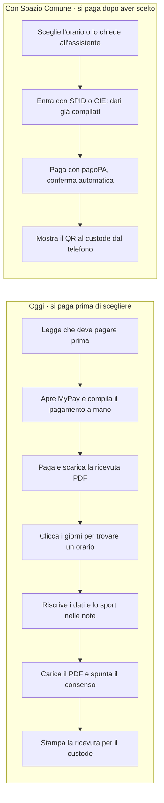
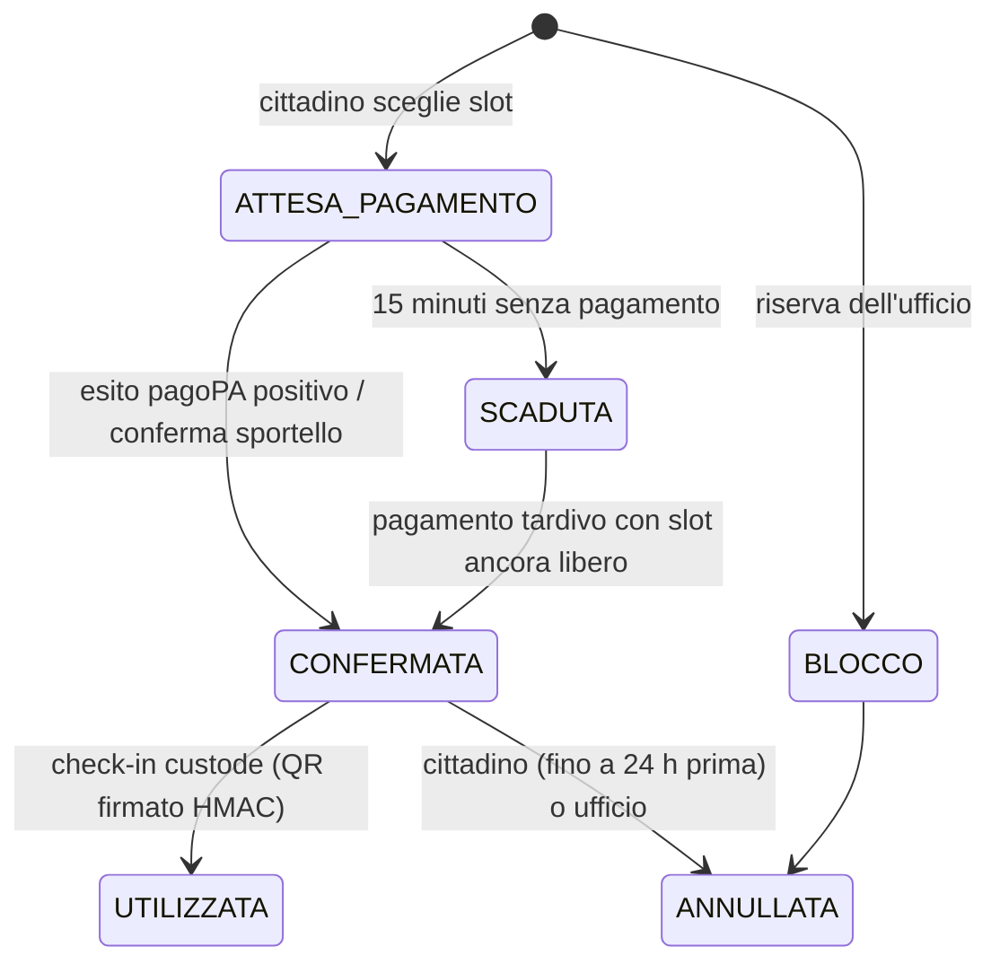

# Spazio Comune – analisi e proposta per il Comune di Gioia del Colle

8 novembre 2026 · Giuseppe Zileni

> Versione Markdown dell'analisi, allineata al codice di questo repository.
> Le parti 1–7 sono la proposta; la parte 8 è la guida per implementare e testare.

## 1. Il problema oggi

Oggi per giocare un'ora a calcetto nel campo di via Benagiano un cittadino deve fare sette passaggi su due portali diversi, e paga prima di aver scelto l'orario. Il servizio è l'unico impianto sportivo presente tra i 22 servizi dell'agenda online del Comune (portale eCOMUNE, pacchetto PNRR).

Il percorso attuale, verificato sul sito l'8 novembre 2026:

1. Leggere nella scheda che serve allegare la ricevuta pagoPA del pagamento già effettuato.
2. Aprire il portale MyPay di Regione Puglia e compilare a mano un pagamento spontaneo, copiando i campi da un'immagine di esempio.
3. Pagare (40 euro calcetto, 10 o 20 euro tennis, D.G.C. 37/2025) e scaricare la ricevuta PDF.
4. Tornare sull'agenda e cliccare i giorni uno alla volta per scoprire gli orari liberi.
5. Scrivere a mano nome, cognome, telefono, email, e nelle note se si gioca a calcetto o a tennis.
6. Caricare il PDF e spuntare "Acconsento" sotto un'informativa privacy di molte pagine.
7. Stampare la ricevuta e portarla al custode.

Se al passo 4 l'orario desiderato è già preso, il cittadino ha pagato per niente e serve un rimborso. Dall'altra parte l'Ufficio Cultura, Istruzione e Sport controlla a vista ogni PDF caricato, senza un collegamento automatico tra prenotazione e incasso.

Sul piano tecnico la pagina usa Bootstrap Italia 1.6.3 e un calendario jQuery UI 1.11.4 del 2015; la scheda del servizio risulta aggiornata l'ultima volta il 29 aprile 2025. Il consenso richiesto nel modulo non è la base giuridica corretta per un servizio pubblico (art. 6.1.e GDPR).

## 2. La proposta in breve

Si propone un modulo "Spazio Comune" che affianca l'agenda attuale solo per gli impianti sportivi: il cittadino sceglie l'orario, entra con SPID o CIE, paga con pagoPA nello stesso flusso e riceve un QR code da mostrare al custode. Gli altri 21 servizi dell'agenda restano come sono.

Il modulo riusa ciò che il Comune ha già. L'interfaccia è costruita con Bootstrap Italia, la libreria ufficiale di Designers Italia già presente nel portale, aggiornata alla versione 2.18.3. I pagamenti passano da MyPay di Regione Puglia, l'intermediario pagoPA che il Comune usa oggi, tramite i servizi per gestionali locali (creazione del dovuto ed esito automatico). Il link resta nella sezione "Prenota appuntamento" del sito, sotto la categoria Impianti sportivi.

Tre principi guidano il progetto:

- **Il cittadino paga solo dopo aver scelto**: l'orario resta riservato 15 minuti mentre paga, poi si libera da solo.
- **L'ufficio non cambia mestiere**: stesse decisioni su aperture, chiusure e riserve, meno controlli manuali.
- **L'intelligenza artificiale aiuta ma non decide**: propone orari e risponde alle domande, la scelta resta della persona.

## 3. Cosa cambia

Il cittadino passa da sette passaggi su due portali a quattro su uno, e paga solo quando l'orario è già suo.



Per l'Ufficio Cultura, Istruzione e Sport il lavoro resta lo stesso, con meno controlli. Da una sola pagina vede le prenotazioni dei prossimi 14 giorni, riserva slot per manutenzioni, scuole o società sportive, registra un pagamento ricevuto allo sportello ed esporta un file per la ragioneria con il codice IUV di ogni incasso. Il calendario si può aprire anche in Outlook o Thunderbird.

Il custode, dal telefono, vede l'elenco del giorno con lo sport previsto (porte da calcetto o rete da tennis) e verifica il QR o il codice dettato a voce; un QR già usato o contraffatto viene segnalato.

## 4. L'assistente IA

L'assistente fa due cose: trasforma una frase come "calcetto venerdì sera alle 20" negli orari liberi più vicini, e risponde alle domande su tariffe, pagamento e annullamento citando la fonte ufficiale. Se l'orario chiesto è occupato propone quelli accanto; se non sa rispondere lo dice e rimanda all'ufficio.

Funziona grazie a un piccolo server di inferenza separato dall'applicazione, compatibile con lo standard di mercato delle API dei modelli linguistici. Di serie usa un motore a regole in italiano che non richiede GPU, non invia dati all'esterno e dà sempre la stessa risposta alla stessa domanda. Il Comune può poi collegare un modello linguistico locale (già previsto nel pacchetto Docker) oppure un servizio cloud qualificato, cambiando solo la configurazione.

Le garanzie sono scritte nel codice e verificate dai test:

- l'assistente non prenota e non paga: propone, e la persona sceglie;
- codice fiscale, email e telefono vengono rimossi dal testo prima di qualsiasi invio a un modello;
- l'interfaccia dichiara che si tratta di intelligenza artificiale e ogni risposta registra quale motore l'ha prodotta;
- se il server IA si ferma il sito continua a funzionare con il calendario classico.

## 5. Conformità normativa

La soluzione è progettata per rispettare le norme in vigore senza nuovi adempimenti straordinari; alcuni passaggi formali restano da completare prima della messa in esercizio.

- **Identità digitale (CAD art. 64)**: accesso con SPID e CIE, delegato al gateway già in uso dal portale o a un proxy certificato; l'app riceve solo nome, cognome, codice fiscale ed email.
- **Pagamenti (CAD art. 5, pagoPA)**: dovuto creato con importo e causale esatti tramite MyPay; serve attivare l'accesso per gestionali locali con Regione Puglia.
- **Design e accessibilità (L. 4/2004, Linee guida AgID, WCAG 2.1 AA)**: Bootstrap Italia ospitato sui server del Comune, pagine utilizzabili anche senza JavaScript; il controllo automatico axe-core non ha trovato violazioni. Restano un test con utenti e l'aggiornamento della dichiarazione di accessibilità.
- **Protezione dei dati (GDPR)**: base giuridica art. 6.1.e al posto del consenso, telefono facoltativo, codice fiscale escluso dagli export contabili. Da aggiornare registro dei trattamenti e nomina del fornitore come responsabile.
- **Intelligenza artificiale (AI Act art. 50, L. 132/2025, Linee guida AgID per l'IA nella PA)**: uso informativo a basso rischio, trasparenza verso l'utente, decisione finale umana, tracciabilità. Prima dell'avvio va fatta la valutazione d'impatto prevista dalle linee guida.
- **Riuso (CAD artt. 68-69)**: codice con licenza EUPL-1.2 e scheda publiccode.yml, pubblicabile su Developers Italia e riusabile da altri Comuni.

Le tariffe applicate sono quelle della D.G.C. 37/2025, centralizzate in un solo punto del codice: una nuova delibera si recepisce in pochi minuti.

## 6. Opportunità di entrate

Un campo da 42 ore prenotabili a settimana, occupato per metà a una tariffa media di 30 euro, vale circa 28.000 euro l'anno; occupato per un quarto, circa 14.000 euro. Sono stime illustrative: il calendario di esempio prevede slot dalle 15 alle 22 dal lunedì al sabato su 44 settimane, mentre oggi online risultano liberi solo pochi slot in alcuni giorni.

Le entrate crescono per tre motivi concreti. Chi oggi rinuncia davanti al pagamento anticipato su un altro portale può prenotare in un minuto dal telefono. Ogni ora libera è visibile e vendibile fino all'ultimo momento, mentre le riserve per manutenzione o società sportive sono tracciate. L'incasso è riconciliato in automatico con il codice IUV di ogni prenotazione, quindi spariscono gli errori e i tempi di verifica dei PDF.

Lo stesso modulo si estende ad altri impianti comunali aggiungendo una scheda di configurazione, senza nuovo sviluppo. Per una stima affidabile serve un dato che il Comune ha già: gli incassi 2025 del tipo dovuto "Utilizzo impianti sportivi" su MyPay e il numero di prenotazioni registrate in agenda.

## 7. Piano di attuazione

Si propone un pilota sul solo campo di via Benagiano, da estendere agli altri impianti solo se i numeri lo giustificano.

1. **Dimostrazione**: il prototipo funzionante viene presentato al Sindaco, all'Ufficio Cultura, Istruzione e Sport e al Responsabile per la transizione digitale.
2. **Attivazioni tecniche**: accesso MyPay per gestionali locali con Regione Puglia, collegamento SPID/CIE, ospitalità su cloud qualificato, link dal portale eCOMUNE.
3. **Pilota di 8 settimane**: prenotazioni reali sul campo di via Benagiano, con il vecchio canale ancora attivo come riserva.
4. **Valutazione ed estensione**: confronto di prenotazioni, incassi e tempo dell'ufficio prima e dopo; poi gli altri impianti.

Decisioni richieste all'Amministrazione:

- [ ] Atto di indirizzo della Giunta per avviare il pilota
- [ ] Incarico al Responsabile per la transizione digitale di coordinare RPD, Ufficio Sport e fornitore del portale
- [ ] Richiesta a Regione Puglia dell'accesso MyPay per gestionali locali
- [ ] Estrazione degli incassi e delle prenotazioni 2025 come base di confronto

---

## 8. Guida all'implementazione e ai test

### 8.1 Struttura del repository

```
spazio-comune/
├── docker-compose.yml        profili: default (app+inference), test, llm (Ollama)
├── tests.Dockerfile          immagine per la suite pytest
├── .env.example              configurazione (copiare in .env)
├── publiccode.yml, LICENSE   riuso (EUPL-1.2)
├── app/
│   ├── Dockerfile
│   ├── scripts/fetch_bootstrap_italia.py   scarica BI 2.18.3 da npm con verifica sha512
│   ├── prenota/
│   │   ├── main.py           FastAPI: rotte cittadino, ufficio, custode, API
│   │   ├── booking.py        dominio: slot, prenotazioni, pagamenti, check-in
│   │   ├── catalog.py        impianti, attività, tariffe D.G.C. 37/2025
│   │   ├── db.py             SQLite, indice univoco anti doppia prenotazione
│   │   ├── ai.py             client inference + base di conoscenza FAQ
│   │   ├── adapters/         identity (SPID/CIE), payments (pagoPA/MyPay), agenda (iCal/CSV)
│   │   ├── templates/        Jinja2 + Bootstrap Italia
│   │   └── static/
│   └── tests/                test_booking.py, test_web.py
├── inference/
│   ├── Dockerfile
│   ├── server.py             API OpenAI-compatibile + /v1/tasks/intent, /v1/tasks/faq
│   ├── rules.py              backend deterministico italiano (intenti, BM25)
│   └── tests/test_inference.py
└── docs/                     ANALISI.md, conformita.md, screenshot/
```

### 8.2 Avvio e test

```bash
cp .env.example .env
docker compose up --build                       # http://localhost:8000
docker compose --profile test run --rm test     # 63 test
docker compose --profile llm up --build         # + LLM locale (qwen2.5:1.5b-instruct su CPU)
```

Senza Docker:

```bash
python -m venv .venv && . .venv/bin/activate
pip install -r app/requirements.txt -r inference/requirements.txt pytest
python app/scripts/fetch_bootstrap_italia.py
pytest
```

Pagine: `/` cittadino · `/ufficio` back-office (Basic auth `UFFICIO_USER`/`UFFICIO_PASSWORD`) · `/custode` (utente `custode`, `CUSTODE_PASSWORD`) · `/api/docs` API.

### 8.3 Ciclo di vita della prenotazione



### 8.4 Cosa copre la suite di test

- **Dominio**: calendario e finestra di 14 giorni, doppia prenotazione impossibile, scadenza dell'attesa, pagamento idempotente, pagamento tardivo con slot libero o perso, orari non validi, annullamento entro 24 ore, riserve ufficio, conferma allo sportello, check-in (valido, ripetuto, contraffatto, fuori orario), export iCal e CSV senza codice fiscale.
- **Web**: flusso completo login → pagamento → ticket con QR, CSRF, protezione open-redirect, ticket visibile solo al titolare, errori chiari su slot occupato, assistente e alternative, FAQ, degrado con server IA spento, back-office protetto, custode, API.
- **Inferenza**: 11 casi di estrazione intenti in italiano, FAQ con fonte, formato OpenAI, redazione PII, backend LLM simulato (validazione dei campi, fallback se il modello non risponde, risposta "non presente").

### 8.5 Dal prototipo alla produzione

- [ ] `MyPaySILGateway` in `adapters/payments.py`: client SOAP per `paaSILInviaDovuti` e `paaSILChiediPagati` con le credenziali di Regione Puglia; aggiungere un job che verifica i pagamenti in attesa.
- [ ] Identità: sostituire `MockIdentity` con il gateway SPID/CIE del portale o un proxy OIDC certificato.
- [ ] Database: PostgreSQL (lo schema SQL è portabile; l'indice univoco parziale è supportato).
- [ ] Calendario reale dell'impianto in `catalog.py` concordato con l'Ufficio Sport.
- [ ] Rate limiting, log di audit delle azioni dell'ufficio, backup, HTTPS con `COOKIE_SECURE=true`.
- [ ] Testi privacy validati dal RPD; dichiarazione di accessibilità aggiornata.
- [ ] Valutazione d'impatto IA secondo le Linee guida AgID prima di attivare un LLM.
- [ ] Repository pubblico + `publiccode.yml` con l'URL definitivo.

### 8.6 Variabili d'ambiente principali

`BASE_URL`, `SECRET_KEY`, `DB_PATH`, `INFERENCE_URL`, `UFFICIO_USER`, `UFFICIO_PASSWORD`, `CUSTODE_PASSWORD`, `FEED_TOKEN`, `TTL_ATTESA_MIN`, `COOKIE_SECURE`; per l'inferenza `INFERENCE_BACKEND` (`rules` | `openai`), `LLM_BASE_URL`, `LLM_MODEL`, `LLM_API_KEY`.

## Fonti

- [Agenda prenotazioni del Comune di Gioia del Colle](https://www.comune.gioiadelcolle.ba.it/area_eagenda_servizi/pagsistema.html)
- [AgID – Intelligenza artificiale](https://www.agid.gov.it/index.php/it/ambiti-intervento/intelligenza-artificiale)
- [MyPay – catalogo Interoperable Europe](https://interoperable-europe.ec.europa.eu/eu-oss-catalogue/solutions/mypay)
