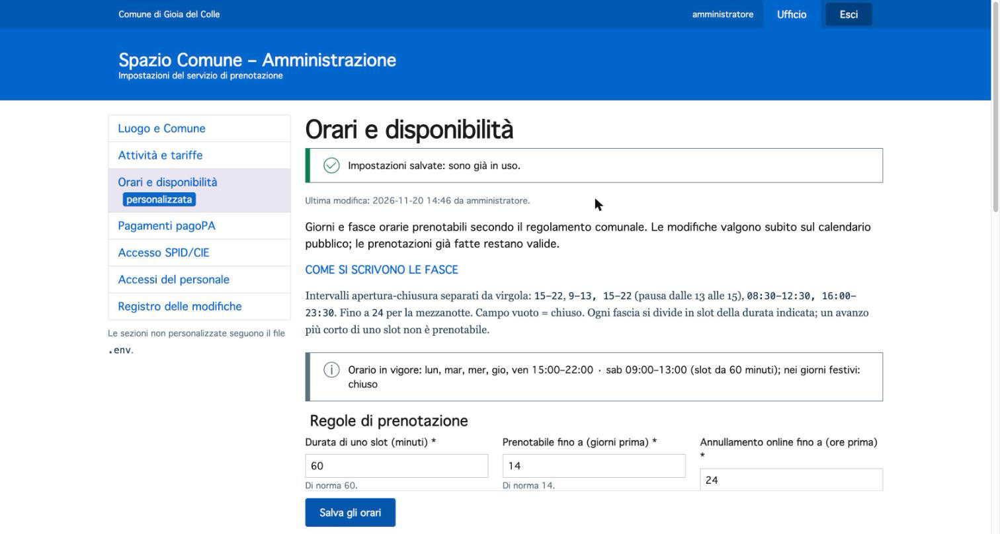

# Amministrazione

La pagina **`/amministrazione`** permette al Comune di impostare il servizio senza toccare file e senza riavviare
nulla. Le modifiche valgono subito per cittadini, ufficio, custode, API e server MCP.



## Chi entra

Solo l'**amministratore**. Le credenziali iniziali sono `ADMIN_USER` e `ADMIN_PASSWORD` del file `.env`: lo script
di installazione su VM le genera da solo. Senza `ADMIN_PASSWORD` la pagina resta chiusa.

- Dopo 10 tentativi sbagliati l'indirizzo IP aspetta 15 minuti.
- La sessione scade dopo 30 minuti di inattività. Se cambiano utente o password dell'amministratore, le altre
  sessioni aperte decadono.
- Ufficio e custode non vedono questa pagina: hanno `/ufficio` e `/custode`.

## Le sezioni

| Sezione | Cosa si imposta |
|---|---|
| **Luogo, Comune e logo** | Logo dell'ente, nome del Comune (titolo dell'intestazione), nome del luogo (sottotitolo), indirizzi, ufficio competente, prefisso dei numeri di prenotazione. Un'anteprima mostra l'intestazione com'è sul sito. |
| **Attività e tariffe** | Cosa si prenota, a quale tariffa (importo del dovuto pagoPA), quanti giocatori, la nota per il custode e la delibera che approva le tariffe. Si possono aggiungere attività nuove; quelle già create non si eliminano, si rendono non prenotabili. Le **fasce tariffarie** danno un importo diverso secondo l'orario: vedi sotto. |
| **Orari e disponibilità** | Le regole del regolamento comunale: vedi sotto. |
| **Pagamenti pagoPA** | Simulazione o MyPay SIL di Regione Puglia (endpoint, codice IPA, tipo dovuto, password SIL) e minuti concessi per pagare. |
| **Accesso SPID/CIE** | **Sola lettura**: mostra la configurazione presa dal file `.env` (il secret mai) e il pulsante *Verifica il gateway*. Si configura nel `.env`: vedi sotto. |
| **Accessi del personale** | Utenti e password di amministratore, ufficio e custode; nuovo indirizzo del calendario iCal dell'ufficio. |
| **Registro delle modifiche** | Chi ha cambiato cosa e quando. |

Ogni sezione ha *Torna ai valori del file .env*, che cancella le modifiche fatte da qui per quella sezione.

## Fasce tariffarie

Quando il regolamento prevede tariffe diverse secondo l'orario (per esempio la tariffa serale con illuminazione
artificiale), in **Attività e tariffe** → *Fasce tariffarie* si indica:

| Campo | Esempio |
|---|---|
| Nome | Serale con illuminazione |
| Dalle / Alle | `19:00` / `24:00` |
| Giorni | nessuno = tutti; oppure solo alcuni (es. sabato e domenica) |
| Importi | calcetto 50,00 €; un'attività lasciata vuota mantiene la tariffa base |

La tariffa vale per gli slot che **iniziano** nella fascia; se più fasce si sovrappongono vale la prima dell'elenco.
Il cittadino vede il prezzo giusto nel calendario e nel riepilogo, e il dovuto pagoPA ha l'importo della fascia.
Le prenotazioni già fatte mantengono l'importo con cui sono state create.

## Orari secondo il regolamento comunale

Le fasce si scrivono come intervalli apertura-chiusura separati da virgola, giorno per giorno:

| Giorno | Fasce | Significato |
|---|---|---|
| Lunedì | `15-22` | slot dalle 15:00 alle 22:00 |
| Mercoledì | `9-13, 15-22` | mattina e pomeriggio, pausa dalle 13 alle 15 |
| Sabato | `08:30-12:30` | anche al minuto |
| Domenica | *(vuoto)* | chiuso |

Ogni fascia si divide in slot della durata scelta (di norma 60 minuti). Si impostano anche:

- **periodi dell'anno** con un orario settimanale diverso, ripetuti ogni anno (es. estate dal 01/06 al 15/09);
- **giorni festivi**: le festività nazionali si calcolano da sole ogni anno, Pasqua compresa. Si sceglie se nei
  festivi il luogo è chiuso, aperto o con orario ridotto, e si aggiungono le festività locali (santo patrono);
- **chiusure straordinarie** tra due date (lavori, eventi, ordinanze): il motivo compare nel calendario pubblico;
- **regole di prenotazione**: durata dello slot, quanti giorni avanti si prenota, fino a quante ore prima si annulla online.

Le prenotazioni già fatte restano valide anche se il nuovo orario non le prevede più. Pagina e ufficio le segnalano
con il numero di prenotazione, così l'ufficio può avvisare gli intestatari.

## SPID e CIE

Il servizio non parla direttamente con gli Identity Provider: si collega via **OpenID Connect** a un gateway già
accreditato, come l'area personale del portale del Comune, il proxy dell'intermediario regionale o un Keycloak/SATOSA
con i plugin SPID e CIE.

Le credenziali del gateway si configurano **solo nel file `.env`** (sulla VM `/etc/spazio-comune/spazio-comune.env`),
non dalla pagina di amministrazione: così restano fuori dal database e sotto il controllo di chi gestisce il server.

1. Comunicare al gestore del gateway il **redirect URI**, per esempio `https://prenota.comune.esempio.it/auth/oidc/callback`.
2. Scrivere nel `.env` i valori ricevuti:

    ```ini
    IDENTITY_BACKEND=oidc
    OIDC_ISSUER=https://login.comune.esempio.it
    OIDC_CLIENT_ID=spazio-comune
    OIDC_CLIENT_SECRET=<fornito dal gestore>
    OIDC_REDIRECT_URI=https://prenota.comune.esempio.it/auth/oidc/callback
    # facoltativi: OIDC_SCOPE, OIDC_ACR_VALUES (es. https://www.spid.gov.it/SpidL2), OIDC_AUTH_METHOD,
    # OIDC_CLAIM_TAX_CODE, OIDC_CLAIM_NAME, OIDC_CLAIM_FAMILY_NAME, OIDC_CLAIM_EMAIL
    ```

3. Riavviare il servizio (`sudo systemctl restart spazio-comune-app` sulla VM, `docker compose up -d --force-recreate`
   con Docker) e in *Accesso SPID/CIE* premere *Verifica il gateway*.

Se una variabile manca o non è valida (issuer o redirect non https, scope senza `openid`…) il servizio **non parte**
e il log indica quale variabile correggere. Senza `OIDC_REDIRECT_URI` si usa `BASE_URL/auth/oidc/callback`.

Da quel momento l'accesso simulato non esiste più. Il flusso usa authorization code con PKCE, `state` e `nonce`.
Il codice fiscale SPID nel formato `TINIT-…` viene normalizzato.

## pagoPA

Con la simulazione il sito avvisa i cittadini che non c'è un addebito reale. Le credenziali di **MyPay SIL** si
salvano già cifrate. Il collegamento effettivo richiede però di completare l'adapter `MyPaySILGateway` con il WSDL
fornito da Regione Puglia: finché non è completato il pagamento online non parte, e l'ufficio può confermare i
pagamenti allo sportello da `/ufficio`.

## Sicurezza dei dati salvati

- Le impostazioni stanno nel database PostgreSQL (tabelle `impostazioni`, `impostazioni_registro` e `logo`), quindi
  sono comprese nei backup.
- Password SIL, client secret e token del calendario sono **cifrati** (Fernet, chiave derivata da `SECRET_KEY`):
  chi legge un backup non li vede in chiaro. Se `SECRET_KEY` cambia, vanno reinseriti e la pagina lo segnala.
- Le password del personale si salvano solo come **hash scrypt**.
- I segreti non tornano mai al browser: un campo segreto lasciato vuoto conserva il valore salvato.
- Il logo accetta solo PNG, JPEG o WebP fino a 512 KB, riconosciuti dal contenuto del file. SVG non è ammesso
  perché può contenere script.

## Per chi sviluppa

L'interfaccia è un'applicazione **React + Vite** in `admin/`. La build è già nel repository e la serve l'app
FastAPI, quindi in esercizio non serve Node.js. Le API JSON sono descritte nel
[README](https://github.com/agent-engineering-studio/spazio-comune#api-di-amministrazione-sessione-dellamministratore--header-x-csrf-token).

```bash
cd admin && npm ci && npm run build    # ricompila l'interfaccia
npm run dev                            # sviluppo su http://localhost:5173/amministrazione (API dall'app su :8000)
```
