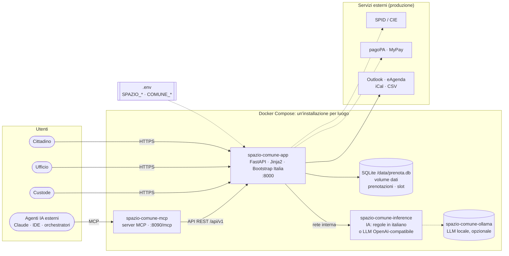
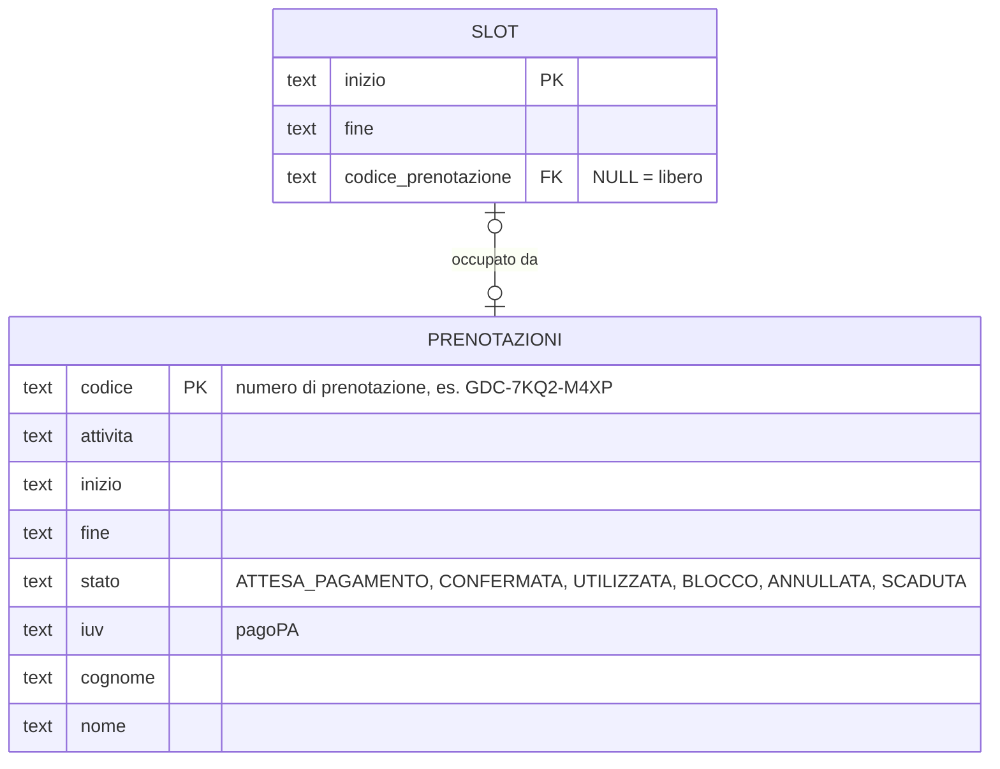
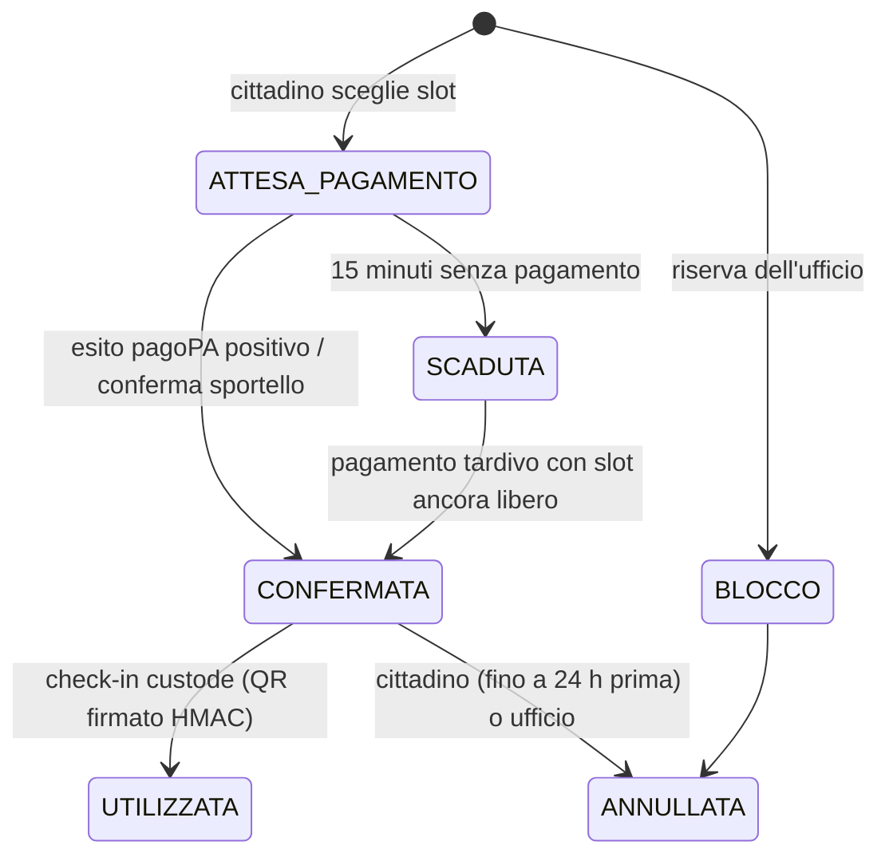

# Architettura

**Un'installazione = un luogo.** Ogni copia del repository gestisce un solo luogo prenotabile, descritto nel
file `.env` (`SPAZIO_*`, `COMUNE_*`). Un Comune con più luoghi installa una copia per ciascuno, con il suo
indirizzo web, il suo database e il suo ufficio di riferimento. Niente multi-sede nel codice: meno
configurazione, meno errori, permessi più semplici.

## Schema architetturale



| Container | Ruolo | Porta |
|---|---|---|
| `spazio-comune-app` | sito, back-office, custode, API REST; **unico** a scrivere il database | 8000 |
| `spazio-comune-inference` | assistente IA (intenti e FAQ); non vede il database né i dati personali | solo rete interna |
| `spazio-comune-mcp` | server MCP per altri agenti; usa solo le API dell'app | 127.0.0.1:8090 |
| `spazio-comune-demo` | istanza con orologio fisso e dati fittizi (profilo `demo`) | 8001 |
| `spazio-comune-ollama`, `-ollama-pull` | LLM locale (profilo `llm`) | solo rete interna |
| `spazio-comune-test` | suite pytest (profilo `test`) | – |

## Il database

Un database c'è: **SQLite**, un file (`/data/prenota.db`) nel volume Docker `dati`. Per un luogo solo non
serve un server di database: il backup è la copia di un file e non c'è un altro servizio da tenere aggiornato.



- **`slot`** ha una riga per ogni orario del calendario e, in `codice_prenotazione`, il **numero della
  prenotazione** che lo occupa. Annullamento e scadenza del pagamento lo riportano a `NULL` nella stessa
  transazione.
- La vista **`v_occupazione`** unisce le due tabelle: per ogni slot stato, numero, attività, intestatario.
  È la stessa informazione della griglia *Occupazione degli slot* in `/ufficio` e dell'API
  `/api/v1/ufficio/occupazione`.
- Doppia prenotazione impossibile per costruzione: indice univoco sugli slot attivi, vincolo `UNIQUE` su
  `slot.codice_prenotazione`, transazioni `BEGIN IMMEDIATE`. Un test lancia 40 prenotazioni simultanee sullo
  stesso slot: ne passa una, le altre 39 ricevono "orario già prenotato".

```bash
docker exec spazio-comune-app python -c "import sqlite3; [print(*r) for r in sqlite3.connect('/data/prenota.db').execute(
  \"SELECT inizio, stato, codice_prenotazione, cognome FROM v_occupazione WHERE codice_prenotazione IS NOT NULL\")]"
```

## Struttura del repository

```
spazio-comune/
├── .env.example              configurazione commentata (sviluppo e produzione)
├── docker-compose.yml        app, inference, mcp; profili demo, llm, test
├── zensical.toml             questo sito
├── app/
│   ├── prenota/
│   │   ├── main.py           rotte cittadino, ufficio, custode, API REST
│   │   ├── booking.py        slot, prenotazioni, pagamenti, check-in
│   │   ├── catalog.py        il luogo (da .env), attività, tariffe
│   │   ├── db.py             SQLite: prenotazioni, slot, v_occupazione
│   │   ├── ai.py             client inferenza + base di conoscenza FAQ
│   │   ├── adapters/         identity, payments, agenda
│   │   └── templates/        Jinja2 + Bootstrap Italia
│   ├── scripts/
│   │   ├── demo.py           istanza con dati fittizi
│   │   ├── simula.py         simulazione di prenotazioni concorrenti
│   │   └── registra_demo.py  video MP4/GIF con Playwright
│   └── tests/
├── inference/                server IA: API OpenAI-compatibile + /v1/tasks/*
├── mcp_server/               server MCP (stdio o HTTP)
└── docs/                     sorgenti del sito
```

## Ciclo di vita della prenotazione



## Scelte principali

- **Un luogo per installazione.** Configurazione nel `.env`, nessuna logica multi-sede.
- **Pagamento idempotente.** `verifica_pagamento` si può chiamare dal ritorno utente, da polling o da notifica.
  Se il pagamento arriva dopo che lo slot è stato preso da altri, viene segnalato il rimborso.
- **Render lato server.** Funziona senza JavaScript: più accessibile e più robusto sui telefoni datati.
- **Tariffe in un solo punto** (`catalog.py`). Una nuova delibera si recepisce in pochi minuti.
- **MCP come porta per gli agenti.** Il server MCP usa le stesse API pubbliche del sito: nessun accesso diretto ai dati.

## Dal prototipo alla produzione

| Componente | Prototipo | Produzione |
|---|---|---|
| SPID/CIE | `MockIdentity` | gateway del portale eCOMUNE o proxy SPID/CIE OIDC certificato |
| pagoPA | `MockPagoPA` | `MyPaySILGateway`: `paaSILInviaDovuti` / `paaSILChiediPagati` con credenziali Regione Puglia |
| Database | SQLite nel volume `dati` | invariato, con backup giornaliero cifrato; host su cloud qualificato ACN |
| IA | motore a regole | invariato, oppure LLM locale dopo la valutazione d'impatto |

- [ ] Client SOAP MyPay SIL e job di verifica dei pagamenti in attesa
- [ ] Integrazione SPID/CIE
- [ ] Calendario reale concordato con l'Ufficio Sport
- [ ] Rate limiting, log di audit dell'ufficio, backup, HTTPS con `COOKIE_SECURE=true`
- [ ] Testi privacy validati dal RPD, dichiarazione di accessibilità aggiornata
- [ ] Valutazione d'impatto IA prima di attivare un LLM
- [ ] Repository pubblico e `publiccode.yml` con l'URL definitivo
