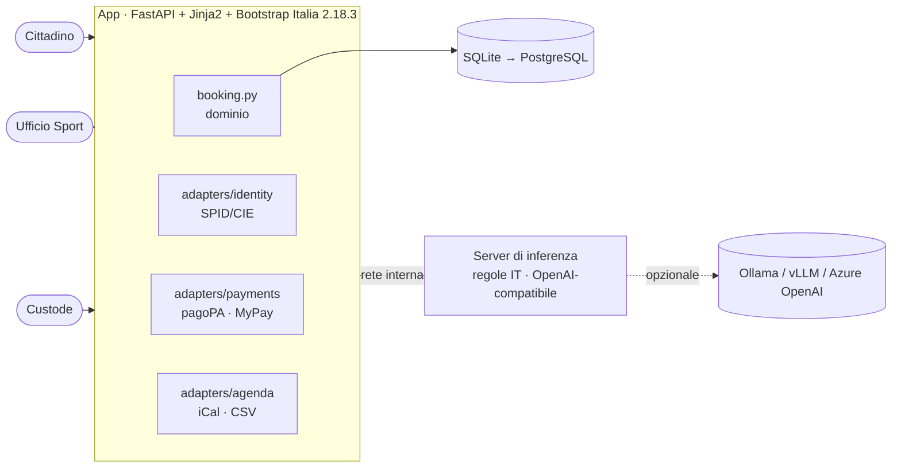
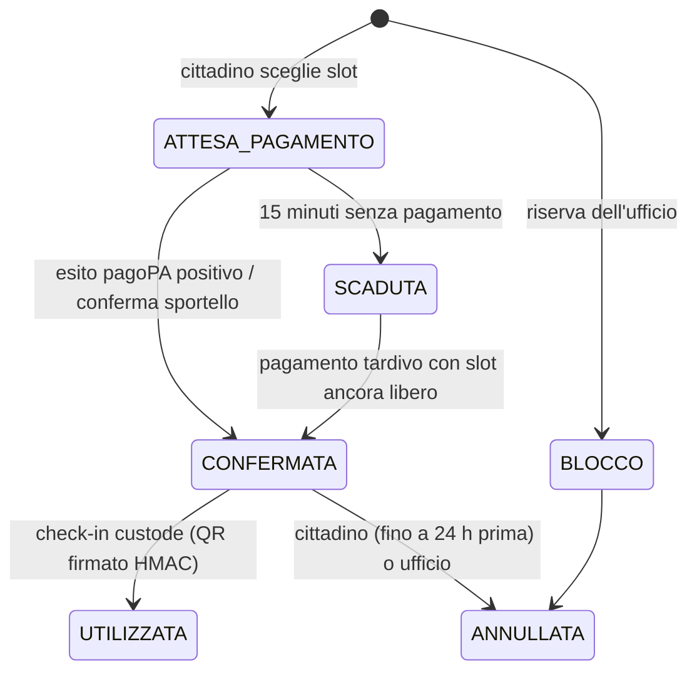

# Architettura



## Struttura del repository

```
spazio-comune/
├── docker-compose.yml        profili: default, demo, llm, test
├── zensical.toml             questo sito
├── app/
│   ├── prenota/
│   │   ├── main.py           rotte cittadino, ufficio, custode, API
│   │   ├── booking.py        slot, prenotazioni, pagamenti, check-in
│   │   ├── catalog.py        impianti, attività, tariffe D.G.C. 37/2025
│   │   ├── db.py             SQLite, indice univoco anti doppia prenotazione
│   │   ├── ai.py             client inferenza + base di conoscenza FAQ
│   │   ├── adapters/         identity, payments, agenda
│   │   └── templates/        Jinja2 + Bootstrap Italia
│   ├── scripts/
│   │   ├── demo.py           istanza con dati fittizi
│   │   └── registra_demo.py  video MP4/GIF con Playwright
│   └── tests/
├── inference/
│   ├── server.py             API OpenAI-compatibile + /v1/tasks/*
│   ├── rules.py              motore deterministico (intenti, BM25)
│   └── tests/
└── docs/                     sorgenti del sito
```

## Ciclo di vita della prenotazione



## Scelte principali

- **Doppia prenotazione impossibile per costruzione.** Un indice univoco parziale su `(impianto, inizio)` per
  gli stati attivi, più transazioni `BEGIN IMMEDIATE`.
- **Pagamento idempotente.** `verifica_pagamento` si può chiamare dal ritorno utente, da polling o da notifica.
  Se il pagamento arriva dopo che lo slot è stato preso da altri, viene segnalato il rimborso.
- **Render lato server.** Funziona senza JavaScript: più accessibile e più robusto sui telefoni datati.
- **Tariffe in un solo punto** (`catalog.py`). Una nuova delibera si recepisce in pochi minuti.
- **Nuovi impianti** con una scheda `Impianto` in `catalog.py`, senza nuovo sviluppo.

## Dal prototipo alla produzione

| Componente | Prototipo | Produzione |
|---|---|---|
| SPID/CIE | `MockIdentity` | gateway del portale eCOMUNE o proxy SPID/CIE OIDC certificato |
| pagoPA | `MockPagoPA` | `MyPaySILGateway`: `paaSILInviaDovuti` / `paaSILChiediPagati` con credenziali Regione Puglia |
| Database | SQLite | PostgreSQL su cloud qualificato ACN |
| IA | motore a regole | invariato, oppure LLM locale dopo la valutazione d'impatto |

- [ ] Client SOAP MyPay SIL e job di verifica dei pagamenti in attesa
- [ ] Integrazione SPID/CIE
- [ ] PostgreSQL (lo schema è portabile, l'indice parziale è supportato)
- [ ] Calendario reale concordato con l'Ufficio Sport
- [ ] Rate limiting, log di audit dell'ufficio, backup, HTTPS con `COOKIE_SECURE=true`
- [ ] Testi privacy validati dal RPD, dichiarazione di accessibilità aggiornata
- [ ] Valutazione d'impatto IA prima di attivare un LLM
- [ ] Repository pubblico e `publiccode.yml` con l'URL definitivo
