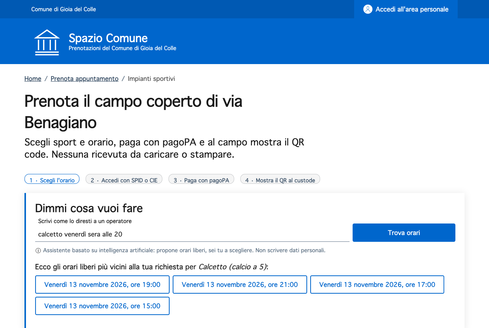
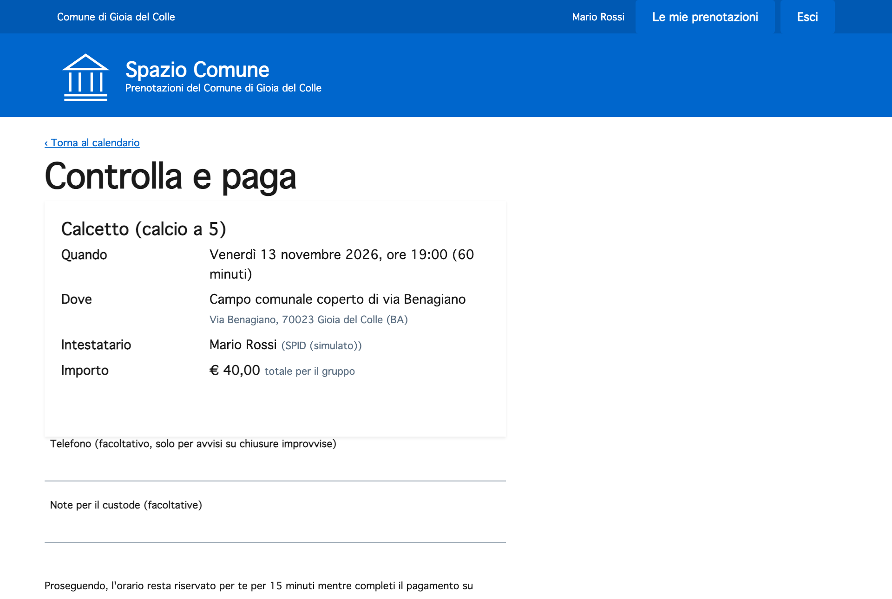
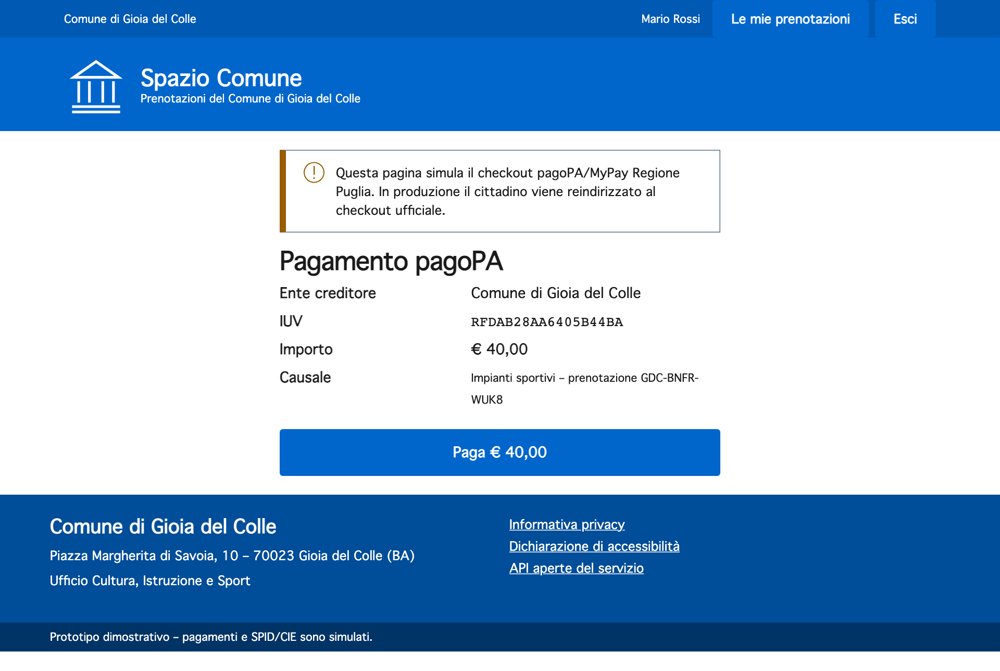
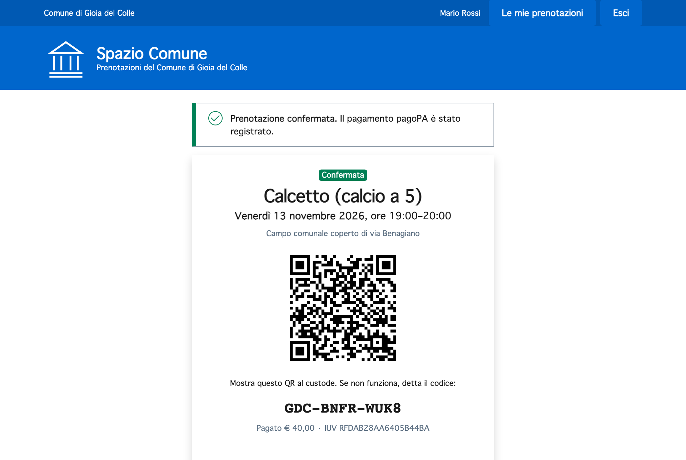
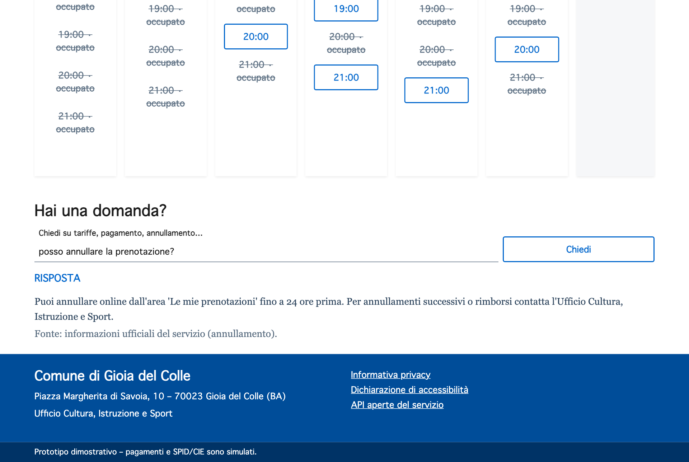

# Per i cittadini

## Prenoti il campo in un minuto, dal telefono

Scegli l'orario, entri con SPID o CIE, paghi con pagoPA e al campo mostri il QR.
Paghi **solo dopo** aver scelto: se l'orario è occupato non perdi niente.

<video class="video-verticale" controls muted playsinline preload="metadata" poster="../demo/verticale-poster.jpg">
  <source src="../demo/spazio-comune-demo-verticale.mp4" type="video/mp4">
</video>

## Cosa cambia per te

| Prima | Adesso |
|---|---|
| Pagavi su un altro portale **prima** di sapere se l'orario era libero | Paghi **dopo** aver scelto, l'orario resta tuo per 15 minuti |
| Cercavi gli orari cliccando un giorno alla volta | Vedi la settimana intera, oppure **lo chiedi all'assistente** |
| Riscrivevi nome, cognome, telefono e sport nelle note | I tuoi dati arrivano da **SPID o CIE** |
| Scaricavi, caricavi e stampavi la ricevuta PDF | Al campo mostri il **QR sul telefono** |
| Per annullare dovevi chiamare l'ufficio | Annulli online **fino a 24 ore prima** |

## I quattro passi

### 1. Chiedi all'assistente, o scegli dal calendario

Scrivi quello che vuoi come lo diresti al telefono:

> *calcetto venerdì sera alle 20* · *tennis doppio domani pomeriggio* · *siamo in 4, tennis sabato mattina*

L'assistente capisce sport, giorno e ora e ti mostra gli **orari liberi più vicini**. Se le 20 sono già prese,
ti propone le 19 o le 21. Tocchi quello che preferisci.

{ loading=lazy }

!!! info "L'assistente ti aiuta, ma decidi tu"
    È un sistema di **intelligenza artificiale**, e la pagina lo dice chiaramente. Propone orari e risponde alle
    domande, ma **non prenota e non paga al posto tuo**: ogni scelta resta tua. Non scrivergli dati personali;
    se lo fai, vengono cancellati prima di qualsiasi elaborazione. Se l'assistente non è disponibile, il
    calendario funziona come sempre.

### 2. Entra con SPID o CIE

Un tocco e sei dentro: nome, cognome e codice fiscale si compilano da soli. Il telefono è facoltativo
e serve solo per avvisarti di chiusure improvvise.

{ loading=lazy }

### 3. Paga con pagoPA

Importo e causale sono già pronti: calcetto **40 €**, tennis singolo **10 €**, tennis doppio **20 €**, per tutto il
gruppo (tariffe D.G.C. 37/2025). Puoi pagare con carta, conto, app IO o, con l'avviso, dal tabaccaio. Non devi
caricare nessuna ricevuta: la conferma arriva in automatico.

{ loading=lazy }

### 4. Mostra il QR al custode

Il QR è sul telefono, in *Le mie prenotazioni*. Se il telefono è scarico, basta dettare il codice
(es. `GDC-BNFR-WUK8`). Il custode sa già se montare le porte da calcetto o la rete da tennis.

{ width=520 loading=lazy }

## Hai una domanda?

In fondo alla pagina chiedi quello che vuoi sapere su tariffe, pagamento, annullamento o privacy.
La risposta viene **solo dalle informazioni ufficiali del servizio** e ne cita la fonte. Se l'assistente
non lo sa, te lo dice e ti indica l'Ufficio Cultura, Istruzione e Sport.

{ loading=lazy }

## Domande frequenti

??? question "Il prezzo è a persona?"
    No, è per l'intero gruppo e per un'ora: 40 € il calcetto, 10 € il tennis singolo, 20 € il doppio.

??? question "Cosa succede se non completo il pagamento?"
    Dopo 15 minuti l'orario torna libero per gli altri. Non ti viene addebitato nulla.

??? question "Posso annullare?"
    Sì, da *Le mie prenotazioni* fino a 24 ore prima. Dopo, o per un rimborso, contatta l'Ufficio Sport.

??? question "I miei dati sono al sicuro?"
    Il Comune tratta solo i dati necessari alla prenotazione e al pagamento, per svolgere un servizio pubblico
    (art. 6.1.e GDPR). All'assistente IA non arrivano i tuoi dati personali.

??? question "E se non ho lo smartphone o SPID?"
    Puoi rivolgerti all'Ufficio Sport, che può riservarti l'orario dal proprio back-office.
