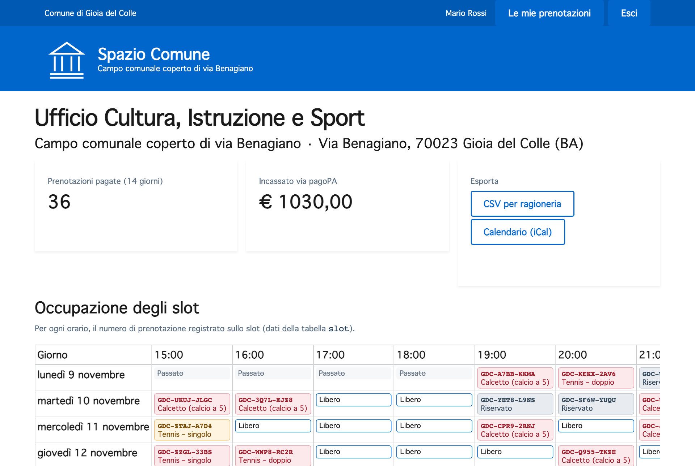
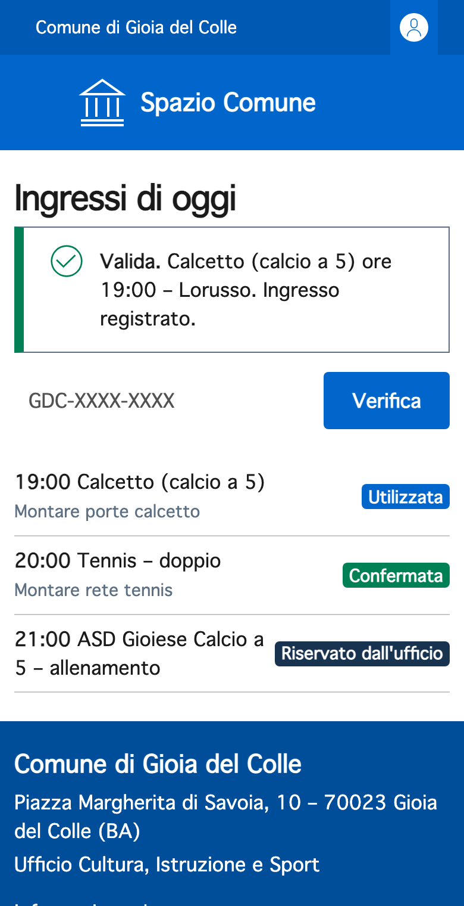

# Per il Comune

## Più ore vendute, meno controlli manuali, un servizio digitale come previsto dal CAD

Spazio Comune affianca l'agenda attuale solo per gli impianti sportivi e riusa ciò che il Comune ha già:
Bootstrap Italia, MyPay di Regione Puglia, SPID e CIE.

## Benefici economici

| Leva | Cosa succede |
|---|---|
| **Meno rinunce** | Chi oggi rinuncia davanti al pagamento anticipato su un altro portale prenota in un minuto dal telefono. |
| **Ogni ora è vendibile** | Gli slot liberi sono visibili fino all'ultimo momento; quelli non pagati tornano liberi dopo 15 minuti. |
| **Incassi riconciliati** | Ogni prenotazione ha il suo codice IUV pagoPA: niente verifica a vista dei PDF, niente errori di abbinamento. |
| **Nessun rimborso per orari occupati** | Si paga dopo aver scelto, quindi spariscono i rimborsi per orari già presi. |
| **Riuso senza nuovo sviluppo** | Un nuovo luogo è una copia del repository con il suo `.env` (nome, indirizzo, orari, attività); il codice è open source (EUPL-1.2) e riusabile da altri Comuni. |

### Stima delle entrate (illustrativa)

Il calendario di esempio prevede slot dalle 15 alle 22, dal lunedì al sabato (**42 ore a settimana**), su
**44 settimane** l'anno, con una tariffa media di **30 €**:

| Occupazione | Ore vendute all'anno | Entrate annue |
|---|---|---|
| 25 % | ≈ 462 | **≈ 14.000 €** |
| 50 % | ≈ 924 | **≈ 28.000 €** |

!!! note "Per una stima affidabile"
    Servono due dati che il Comune ha già: gli incassi 2025 del tipo dovuto *Utilizzo impianti sportivi* su MyPay
    e il numero di prenotazioni registrate in agenda. Sono la base di confronto per il pilota.

## Benefici per i servizi

-   :material-account-tie: **Ufficio Cultura, Istruzione e Sport**

    ---

    Stesse decisioni di oggi su aperture, chiusure e riserve. Da una sola pagina vede i prossimi 14 giorni,
    riserva slot per manutenzioni, scuole e società, registra i pagamenti allo sportello ed esporta il CSV per la
    ragioneria con lo IUV di ogni incasso. Il calendario si apre in Outlook o Thunderbird.

-   :material-cellphone-check: **Custode**

    ---

    Dal telefono vede gli ingressi del giorno con lo sport previsto (porte o rete), verifica il QR o il codice
    dettato a voce; un QR già usato o contraffatto viene segnalato.

-   :material-account-group: **Cittadini**

    ---

    Quattro passi invece di sette, un solo portale, pagamento dopo la scelta, assistente in linguaggio naturale.
    [Vedi la parte per i cittadini](cittadini.md).

-   :material-chart-line: **Amministrazione**

    ---

    Dati certi su occupazione e incassi per decidere tariffe, orari ed estensione ad altri impianti.

{ loading=lazy }

## Intelligenza artificiale sotto controllo

L'assistente IA è progettato per una PA: **informa, non decide**.

- **Rischio basso.** Uso informativo: trova orari e risponde alle FAQ. Non prenota, non paga e non valuta le persone.
- **Trasparenza** (AI Act art. 50). L'interfaccia dichiara che è IA e ogni risposta registra il motore che l'ha prodotta.
- **Decisione umana** (L. 132/2025). La scelta finale resta sempre al cittadino.
- **Dati che restano al Comune.** Il motore predefinito gira sui server del Comune, senza GPU e senza inviare dati a terzi. Un LLM si aggiunge solo se il Comune lo decide, locale o cloud qualificato, cambiando la configurazione.
- **Nessuna dipendenza.** Se l'IA si ferma, il servizio continua con il calendario.

[Approfondimento tecnico sull'IA](intelligenza-artificiale.md){ .md-button }

## Come funziona il servizio

=== "Ufficio Sport"

    { loading=lazy }

    | Azione | Dove |
    |---|---|
    | Vedere le prenotazioni dei prossimi 14 giorni con stato e IUV | `/ufficio` |
    | Riservare uno slot (manutenzione, scuola, società) | *Riserva uno slot* |
    | Registrare un pagamento ricevuto allo sportello | *Conferma* sulla riga in attesa |
    | Annullare una prenotazione anche a meno di 24 ore | *Annulla* |
    | Esportare per la ragioneria (senza codice fiscale) | *CSV per ragioneria* |
    | Abbonarsi al calendario | *Calendario (iCal)* |

=== "Custode"

    { width=320 loading=lazy }

    | Esito | Significato |
    |---|---|
    | **Valida** | pagata e nell'orario (±2 ore): ingresso registrato |
    | **QR già utilizzato** | il ticket è già stato usato |
    | **Valida ma per un altro orario** | la prenotazione è per un altro giorno o ora |
    | **QR non valido o contraffatto** | la firma digitale non corrisponde |

## Piano di attuazione

1. **Dimostrazione** al Sindaco, all'Ufficio Sport e al Responsabile per la transizione digitale.
2. **Attivazioni tecniche:** accesso MyPay per gestionali locali con Regione Puglia, collegamento SPID/CIE, ospitalità su cloud qualificato, link dal portale eCOMUNE.
3. **Pilota di 8 settimane** sul campo di via Benagiano, con il vecchio canale ancora attivo come riserva.
4. **Valutazione ed estensione:** confronto di prenotazioni, incassi e tempo dell'ufficio prima e dopo.

### Decisioni richieste all'Amministrazione

- [ ] Atto di indirizzo della Giunta per avviare il pilota
- [ ] Incarico al Responsabile per la transizione digitale di coordinare RPD, Ufficio Sport e fornitore
- [ ] Richiesta a Regione Puglia dell'accesso MyPay per gestionali locali
- [ ] Estrazione di incassi e prenotazioni 2025 come base di confronto

Approfondimenti: [Analisi e proposta completa](ANALISI.md) · [Conformità normativa](conformita.md)
