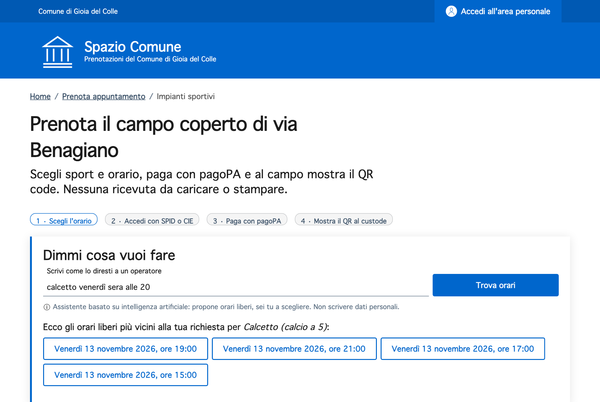
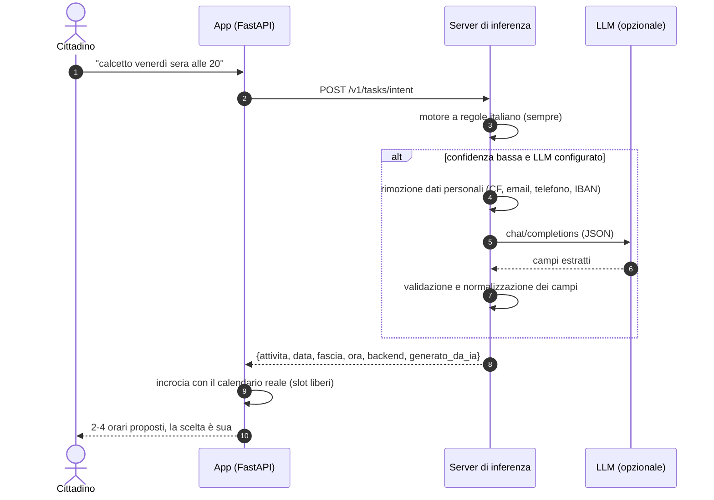

# L'assistente IA

> **L'IA propone, la persona decide.** L'assistente trova gli orari e risponde alle domande;
> non prenota e non paga mai al posto del cittadino.

<video class="video-verticale" controls muted playsinline preload="metadata" poster="../demo/verticale-poster.jpg">
  <source src="../demo/spazio-comune-demo-verticale.mp4" type="video/mp4">
</video>

## Cosa fa

<div class="grid cards" markdown>

-   :material-calendar-search: **Dalla frase all'orario**

    ---

    Il cittadino scrive come parlerebbe a un operatore: *"calcetto venerdì sera alle 20"*.
    L'assistente ricava sport, giorno, fascia e ora e mostra **gli slot liberi più vicini**.
    Se le 20 sono già prese propone le 19 e le 21: così nessuno paga per un orario occupato.

-   :material-frequently-asked-questions: **Risposte con la fonte**

    ---

    *"Posso annullare la prenotazione?"* La risposta viene **solo** dalla base di conoscenza ufficiale del servizio
    (tariffe D.G.C. 37/2025, pagamento, annullamento, privacy…) e cita la fonte.
    Se la risposta non c'è, lo dice e rimanda all'Ufficio Sport.

</div>

{ loading=lazy }

## Come è fatto

L'IA vive in un **server di inferenza separato** (`inference/`), raggiungibile solo dall'app sulla rete interna
di Docker e compatibile con lo standard di mercato delle API dei modelli linguistici (formato OpenAI).



### Due motori, una sola interfaccia

| | `rules` (predefinito) | `openai` (opzionale) |
|---|---|---|
| Cosa è | motore deterministico in italiano: estrazione di intenti con regole e ricerca FAQ con BM25 | qualsiasi endpoint compatibile OpenAI: **Ollama**, vLLM, llama.cpp, Azure OpenAI |
| Hardware | nessuna GPU, pochi MB di RAM | CPU (modello piccolo, es. `qwen2.5:1.5b-instruct`) o GPU / cloud |
| Dati | **non escono dal container** | redatti prima dell'invio; restano nel Comune se l'LLM è locale |
| Ripetibilità | stessa domanda, **stessa risposta** | temperatura 0, output validato dal codice |
| Quando interviene | sempre | solo se il motore a regole ha confidenza < 0,67 (intenti) o per riformulare le FAQ |

Il modello linguistico **estrae** e basta: date relative ("domani", "venerdì"), orari validi e attività ammesse
vengono sempre risolti e controllati dal codice. Un campo non valido restituito dal modello viene scartato.

### Esempi reali

Risposte del server di inferenza (`backend: rules`) con data di riferimento lunedì 9 novembre 2026:

| Frase | Attività | Data | Fascia | Ora |
|---|---|---|---|---|
| calcetto venerdì sera alle 20 | calcetto | 2026-11-13 | sera | 20:00 |
| tennis doppio domani pomeriggio | tennis_doppio | 2026-11-10 | pomeriggio | — |
| siamo in 4, tennis sabato mattina | tennis_doppio (4 giocatori) | 2026-11-14 | mattina | — |
| una partitella il 20 novembre alle 18 | calcetto | 2026-11-20 | sera | 18:00 |

```bash
# dal container app (il server di inferenza non è pubblicato all'esterno)
docker exec spazio-comune-app python -c "import httpx; print(httpx.post(
  'http://inference:8080/v1/tasks/intent',
  json={'testo': 'calcetto venerdì sera alle 20', 'oggi': '2026-11-09'}).json())"
```

```json
{"attivita": "calcetto", "data": "2026-11-13", "fascia": "sera", "ora": "20:00",
 "giocatori": null, "confidenza": 1.0, "backend": "rules", "generato_da_ia": false}
```

### API del server di inferenza

| Endpoint | Uso |
|---|---|
| `GET /health` | stato, backend e modello attivo |
| `GET /v1/models` | elenco modelli (formato OpenAI) |
| `POST /v1/tasks/intent` | testo libero → `{attivita, data, fascia, ora, giocatori, confidenza}` |
| `POST /v1/tasks/faq` | domanda + documenti → risposta fondata **solo** sui documenti, con `fonti` |
| `POST /v1/chat/completions` | compatibilità OpenAI: proxy verso l'LLM, con redazione dei dati personali |

## Garanzie scritte nel codice

Ogni garanzia è verificata da test automatici (`inference/tests/test_inference.py`, `app/tests/test_web.py`).

- [x] **Non prenota e non paga.** Nessun endpoint di inferenza modifica prenotazioni o pagamenti; l'assistente restituisce link a slot che il cittadino sceglie.
- [x] **Dati personali rimossi.** Codice fiscale, email, telefono e IBAN vengono sostituiti (`[CODICE_FISCALE]`, `[EMAIL]`…) prima di qualsiasi invio a un modello.
- [x] **Trasparenza.** L'interfaccia dichiara che l'assistente è basato su IA e invita a non scrivere dati personali; ogni risposta riporta `backend` e `generato_da_ia`.
- [x] **Niente invenzioni.** Le FAQ rispondono solo dai documenti ufficiali; se il modello risponde `NON_PRESENTE`, l'app rimanda all'ufficio.
- [x] **Degrado controllato.** Se il server IA è spento o l'LLM non risponde entro il timeout, il sito funziona con il calendario classico e il motore a regole.
- [x] **Rete interna.** Il server di inferenza è esposto solo all'app (`expose`, non `ports`).

## Collegare un modello linguistico

=== "LLM locale (Ollama, nel pacchetto)"

    Nessun dato esce dal server del Comune. Il modello predefinito è piccolo e gira su CPU.

    ```bash
    # .env
    INFERENCE_BACKEND=openai
    LLM_BASE_URL=http://ollama:11434/v1
    LLM_MODEL=qwen2.5:1.5b-instruct
    LLM_API_KEY=ollama
    ```

    ```bash
    docker compose --profile llm up --build -d
    docker logs -f spazio-comune-ollama-pull   # attendere il download del modello
    ```

=== "Servizio cloud (Azure OpenAI o altro)"

    Da usare solo con un fornitore **qualificato ACN** e dopo la valutazione d'impatto.

    ```bash
    # .env
    INFERENCE_BACKEND=openai
    LLM_BASE_URL=https://<risorsa>.openai.azure.com/openai/v1
    LLM_MODEL=<nome-deployment>
    LLM_API_KEY=<chiave>
    ```

    ```bash
    docker compose up -d --force-recreate inference
    ```

=== "Solo regole (predefinito)"

    ```bash
    # .env
    INFERENCE_BACKEND=rules
    ```

Verifica del backend attivo:

```bash
docker exec spazio-comune-app python -c "import httpx; print(httpx.get('http://inference:8080/health').json())"
# {'stato': 'ok', 'backend': 'rules', 'modello': 'rules-it-v1'}
```

## Quadro normativo

| Norma | Come è rispettata |
|---|---|
| **AI Act, art. 50** (trasparenza) | l'interfaccia dichiara l'uso di IA; ogni risposta registra il motore che l'ha prodotta |
| **L. 132/2025** (decisione umana) | l'IA propone, la scelta dello slot e il pagamento restano alla persona |
| **Linee guida AgID per l'IA nella PA** | uso informativo a basso rischio, tracciabilità, motore locale di default |
| **GDPR** (minimizzazione) | redazione dei dati personali prima dell'invio, nessun dato al modello nel backend `rules` |

!!! note "Prima di attivare un LLM in produzione"
    Va svolta la **valutazione d'impatto** prevista dalle Linee guida AgID e il sistema va iscritto nel registro
    dei sistemi IA dell'ente. Vedi [Conformità normativa](conformita.md).
