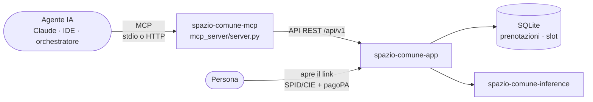

# Server MCP

Spazio Comune include un server **MCP** ([Model Context Protocol](https://modelcontextprotocol.io)) in Python,
basato sull'SDK ufficiale `mcp` (FastMCP). Con questo server, assistenti e sistemi agentici come Claude
Desktop, Claude Code, gli IDE o un orchestratore del Comune consultano il luogo con gli stessi dati del sito:
orari liberi, tariffe, regole e, per l'ufficio, i numeri di prenotazione.



!!! abstract "L'agente propone, la persona decide"
    Nessuno strumento prenota o paga. `link_prenotazione` verifica lo slot e restituisce il link che la persona
    apre per completare la prenotazione con SPID/CIE e pagoPA. Il server MCP passa **solo** dalle API REST
    dell'app: non legge il database e non conosce i segreti dell'app.

## Strumenti

| Strumento | Per | Cosa fa |
|---|---|---|
| `info_spazio` | tutti | luogo, Comune, ufficio, orari, attività e tariffe |
| `disponibilita(dal, giorni, solo_liberi)` | tutti | calendario con lo stato di ogni slot: `libero`, `occupato`, `in_pagamento`, `riservato`, `passato` |
| `cerca_orari(richiesta)` | tutti | dalla frase *"calcetto venerdì sera alle 20"* a un massimo di 4 orari liberi, ognuno con il suo link |
| `domanda(testo)` | tutti | FAQ su tariffe, pagamento, annullamento, privacy, con le fonti ufficiali |
| `link_prenotazione(inizio, attivita)` | tutti | controlla che lo slot sia libero e restituisce il link di prenotazione |
| `occupazione_slot(dal, giorni)` | ufficio | per ogni slot, il **numero di prenotazione** registrato, lo stato e l'intestatario |
| `dettaglio_prenotazione(codice)` | ufficio | dettaglio di una prenotazione dal suo numero, senza codice fiscale |

Gli strumenti dell'ufficio esistono solo se `MCP_UFFICIO_USER` e `MCP_UFFICIO_PASSWORD` sono valorizzati nel
`.env`, con le stesse credenziali del back-office.

## Collegare un agente

=== "HTTP (container Docker)"

    Il container `spazio-comune-mcp` parte con lo stack e risponde su `http://localhost:8090/mcp`
    (trasporto *streamable HTTP*, porta pubblicata solo su `127.0.0.1`).

    ```bash
    docker compose up -d
    claude mcp add --transport http spazio-comune http://localhost:8090/mcp
    ```

=== "stdio (Claude Desktop, IDE)"

    ```json
    {
      "mcpServers": {
        "spazio-comune": {
          "command": "python",
          "args": ["/percorso/spazio-comune/mcp_server/server.py"],
          "env": { "SPAZIO_COMUNE_URL": "http://localhost:8000" }
        }
      }
    }
    ```

    Requisiti: `pip install -r mcp_server/requirements.txt`.

=== "VS Code · Cursor"

    ```json
    // VS Code, GitHub Copilot in modalità agente: .vscode/mcp.json
    { "servers": { "spazio-comune": { "type": "http", "url": "http://localhost:8090/mcp" } } }

    // Cursor: ~/.cursor/mcp.json
    { "mcpServers": { "spazio-comune": { "url": "http://localhost:8090/mcp" } } }
    ```

=== "OpenAI Agents SDK"

    ```python
    from agents import Agent, Runner
    from agents.mcp import MCPServerStreamableHttp

    async with MCPServerStreamableHttp(params={"url": "http://localhost:8090/mcp"}, name="spazio-comune") as mcp:
        agente = Agent(name="Prenotazioni", instructions="Aiuta a trovare un orario libero.", mcp_servers=[mcp])
        print((await Runner.run(agente, "C'è posto per un calcetto venerdì sera?")).final_output)
    ```

=== "LangChain / LangGraph"

    ```python
    from langchain_mcp_adapters.client import MultiServerMCPClient

    client = MultiServerMCPClient({"spazio-comune": {"transport": "streamable_http", "url": "http://localhost:8090/mcp"}})
    tools = await client.get_tools()   # es. create_react_agent(model, tools)
    ```

=== "Debug"

    ```bash
    npx @modelcontextprotocol/inspector          # trasporto Streamable HTTP, URL http://localhost:8090/mcp
    curl -i -X POST http://localhost:8090/mcp \
      -H "Content-Type: application/json" -H "Accept: application/json, text/event-stream" \
      -d '{"jsonrpc":"2.0","id":1,"method":"initialize","params":{"protocolVersion":"2025-06-18","capabilities":{},"clientInfo":{"name":"curl","version":"1"}}}'
    ```

=== "Istanza demo"

    Per provare con i dati fittizi, punta il server all'istanza demo:

    ```bash
    SPAZIO_COMUNE_URL=http://localhost:8001 \
    SPAZIO_COMUNE_UFFICIO_USER=ufficio.sport SPAZIO_COMUNE_UFFICIO_PASSWORD=cambiami \
    MCP_TRANSPORT=http MCP_PORT=8091 python mcp_server/server.py
    ```

## Esempio

Richiesta di un agente a `cerca_orari` con `"tennis doppio domani sera"`:

```json
{
  "intento": {"attivita": "tennis_doppio", "data": "2026-11-09", "fascia": "sera", "backend": "rules"},
  "proposte": [
    {"data": "2026-11-09", "ora": "18:00", "stato": "libero",
     "link_prenotazione": "http://localhost:8000/prenota?inizio=2026-11-09T18%3A00%3A00%2B01%3A00&attivita=tennis_doppio"},
    {"data": "2026-11-09", "ora": "19:00", "stato": "libero", "link_prenotazione": "…"}
  ]
}
```

## Variabili

| Variabile | Predefinito | Descrizione |
|---|---|---|
| `SPAZIO_COMUNE_URL` | `http://localhost:8000` | Indirizzo dell'app (in Docker `http://app:8000`). |
| `MCP_TRANSPORT` | `stdio` | `stdio` oppure `http` (*streamable HTTP* su `/mcp`). Il container usa `http`. |
| `MCP_HOST` / `MCP_PORT` | `127.0.0.1` / `8090` | Interfaccia e porta del trasporto HTTP. |
| `MCP_ALLOWED_HOSTS` | `localhost:*,127.0.0.1:*` | Header `Host` ammessi; le richieste con altri host ricevono `400` (protezione da DNS rebinding). |
| `SPAZIO_COMUNE_UFFICIO_USER` / `_PASSWORD` | vuote | Credenziali dell'ufficio; nel `.env` si chiamano `MCP_UFFICIO_USER` / `MCP_UFFICIO_PASSWORD`. |

## Sicurezza

- **Minimo privilegio.** Il server usa le API pubbliche; gli strumenti dell'ufficio sono spenti finché non si
  danno le credenziali, e non restituiscono mai il codice fiscale.
- **Rete.** La porta 8090 è pubblicata solo su `127.0.0.1`. Per agenti su altre macchine, va esposta dietro
  reverse proxy con autenticazione e con il suo host in `MCP_ALLOWED_HOSTS`.
- **Nessun dato personale richiesto.** Le istruzioni del server dicono all'agente di non chiedere né inviare
  codice fiscale, telefono o email.
- **Test.** `app/tests/test_mcp.py` prova tutti gli strumenti contro l'app reale tramite il protocollo MCP.
